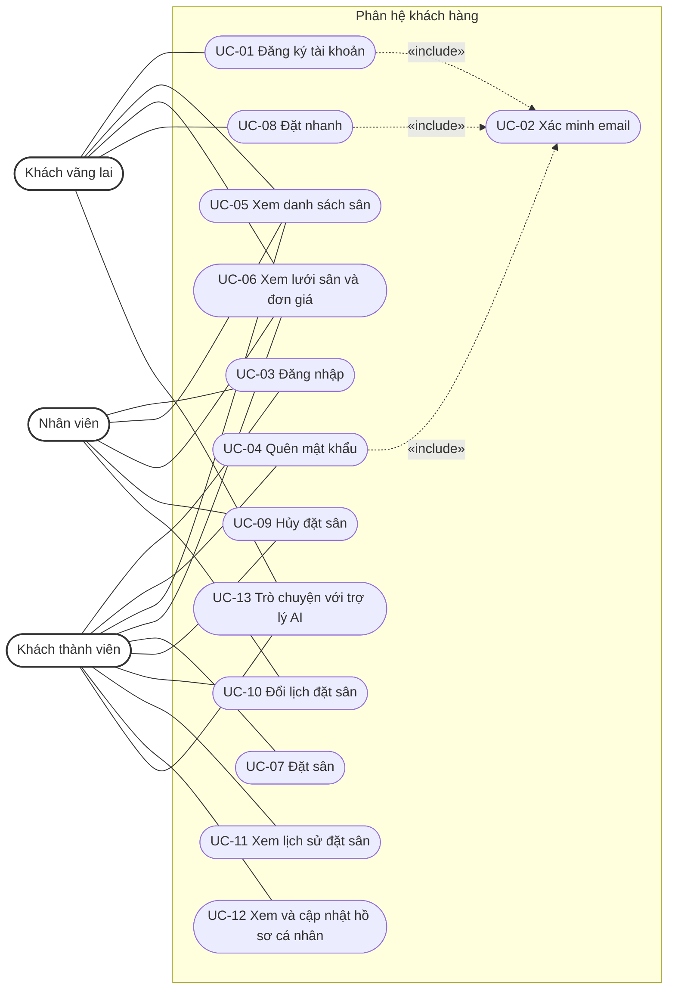
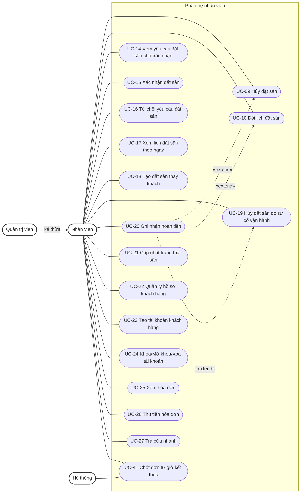
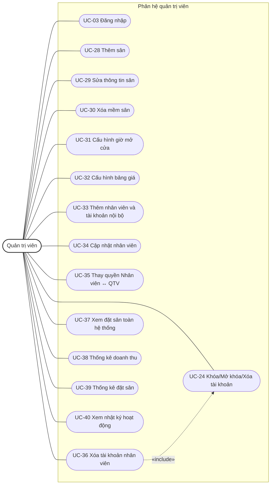

# Mô hình Usecase

**Hệ thống đặt sân cầu lông** · Phiên bản 2.0 · 28/10/2026

**Sinh viên thực hiện:**

- 24522000 – Nguyễn Bảo Việt
- 24520856 – Đinh Nhật Khôi

## Bảng ghi nhận thay đổi tài liệu

| Ngày | Phiên bản | Mô tả | Tác giả |
| --- | --- | --- | --- |
| 09/10/2026 | 1.0 | Khởi tạo mô hình Use-case từ SRS phiên bản 1.2 | Nguyễn Bảo Việt, Đinh Nhật Khôi |
| 10/10/2026 | 1.1 | Đồng bộ SRS 1.3: bỏ tạo đơn cho lượt đã diễn ra | Nguyễn Bảo Việt, Đinh Nhật Khôi |
| 10/10/2026 | 1.2 | Đồng bộ SRS 1.4: trạng thái tài khoản, xóa tài khoản vĩnh viễn, phạm vi phiên | Nguyễn Bảo Việt, Đinh Nhật Khôi |
| 10/10/2026 | 1.3 | Đồng bộ SRS 1.5: bỏ lịch mở kế hoạch và tỷ lệ lấp đầy | Nguyễn Bảo Việt, Đinh Nhật Khôi |
| 10/10/2026 | 1.4 | Đồng bộ SRS 1.6: bỏ đổi email; nhật ký tự động, chỉ đọc | Nguyễn Bảo Việt, Đinh Nhật Khôi |
| 10/10/2026 | 1.5 | Đồng bộ SRS 1.7: bỏ trường lý do khỏi nhật ký | Nguyễn Bảo Việt, Đinh Nhật Khôi |
| 28/10/2026 | 1.6 | Đồng bộ SRS 1.8: đổi lịch ngay, hóa đơn/thu/hoàn tiền, chốt giờ kết thúc, email bền vững | Nguyễn Bảo Việt, Đinh Nhật Khôi |
| 28/10/2026 | 2.0 | Viết lại theo SRS 2.0: luồng chính chỉ gồm đường thành công; quy tắc dùng chung chuyển lên đầu mục 4; gộp use-case Lập hóa đơn vào Xác nhận đặt sân, bỏ use-case Ghi nhận lượt sử dụng và mã đã loại trước đó, đánh số lại liền mạch còn 41 use-case; sửa mâu thuẫn email ở UC cập nhật nhân viên | Nguyễn Bảo Việt, Đinh Nhật Khôi |

## Mục lục

1. Sơ đồ Use-case
2. Danh sách các Actor
3. Danh sách các Use-case
4. Đặc tả Use-case
   - 4.1 – 4.13: Phân hệ khách hàng (UC-01 – UC-13)
   - 4.14 – 4.27: Phân hệ nhân viên (UC-14 – UC-27)
   - 4.28 – 4.40: Phân hệ quản trị viên (UC-28 – UC-40)
   - 4.41: Chốt đơn từ giờ kết thúc, do hệ thống tự chạy hoặc nhân viên kích hoạt (UC-41)

---

## 1. Sơ đồ Use-case

Sơ đồ chia theo phân hệ. QTV kế thừa use-case của Nhân viên.

### 1.1 Phân hệ khách hàng

### 1.2 Phân hệ nhân viên

### 1.3 Phân hệ quản trị viên

---

## 2. Danh sách các Actor

| STT | Tên Actor | Ý nghĩa/Ghi chú |
| --- | --- | --- |
| 1 | Khách vãng lai | Người đặt nhanh khi chưa đăng nhập (họ tên, số điện thoại, email); xem sân, lưới sân, giá; dùng trợ lý AI. |
| 2 | Khách thành viên | Khách hàng có tài khoản; đặt, hủy, đổi lịch, xem lịch sử và hồ sơ của mình. Đăng nhập và quên mật khẩu do khách này thực hiện. |
| 3 | Nhân viên | Người dùng nội bộ có tài khoản do QTV cấp; xử lý đặt sân, khách hàng, hóa đơn, trạng thái sân. |
| 4 | Quản trị viên (QTV) | Nhân viên có quyền quản trị; kế thừa mọi quyền của Nhân viên, thêm quản lý sân, giá, tài khoản nội bộ, thống kê, nhật ký. Use-case ghi actor "Nhân viên" thì QTV cũng thực hiện được. |
| 5 | Hệ thống | Tự chốt đơn từ giờ kết thúc theo lịch (UC-41, BR-17). Nhân viên chỉ kích hoạt việc kiểm tra và chốt này, không tự chọn kết quả. |

---

## 3. Danh sách các Use-case

| STT | Tên Use-case | Actor | Ý nghĩa/Ghi chú |
| --- | --- | --- | --- |
| 1 | UC-01 Đăng ký tài khoản | Khách vãng lai | Tự đăng ký tài khoản, liên kết hồ sơ Khách hàng. |
| 2 | UC-02 Xác minh email | Khách vãng lai, Khách thành viên | Xác minh quyền dùng email bằng mã 6 chữ số; được UC-01, UC-04, UC-08 gọi đến. |
| 3 | UC-03 Đăng nhập | Khách thành viên, Nhân viên, QTV | Đăng nhập bằng email và mật khẩu. |
| 4 | UC-04 Quên mật khẩu | Khách thành viên | Đặt lại mật khẩu sau khi xác minh email. |
| 5 | UC-05 Xem danh sách sân | Khách vãng lai, Khách thành viên, Nhân viên | Xem tên, mô tả, trạng thái sân. |
| 6 | UC-06 Xem lưới sân và đơn giá | Khách vãng lai, Khách thành viên, Nhân viên | Xem tình trạng slot theo ngày và đơn giá theo khung giờ. |
| 7 | UC-07 Đặt sân | Khách thành viên | Tạo đặt sân ở trạng thái Chờ xác nhận. |
| 8 | UC-08 Đặt nhanh | Khách vãng lai | Đặt sân không cần tài khoản, có xác minh email. |
| 9 | UC-09 Hủy đặt sân | Khách thành viên, Nhân viên | Hủy đơn theo yêu cầu khách (nhân viên làm thay được). |
| 10 | UC-10 Đổi lịch đặt sân | Khách thành viên, Nhân viên | Đổi sân, ngày, giờ của đơn. |
| 11 | UC-11 Xem lịch sử đặt sân | Khách thành viên | Xem danh sách và chi tiết đơn của mình. |
| 12 | UC-12 Xem và cập nhật hồ sơ cá nhân | Khách thành viên | Xem hồ sơ; chỉ sửa họ tên, số điện thoại. |
| 13 | UC-13 Trò chuyện với trợ lý AI | Khách vãng lai, Khách thành viên | Tư vấn dựa trên dữ liệu công khai. |
| 14 | UC-14 Xem yêu cầu đặt sân chờ xác nhận | Nhân viên | Xem danh sách và chi tiết đơn Chờ xác nhận. |
| 15 | UC-15 Xác nhận đặt sân | Nhân viên | Chuyển Chờ xác nhận → Đã xác nhận và lập hóa đơn. |
| 16 | UC-16 Từ chối yêu cầu đặt sân | Nhân viên | Hủy đơn Chờ xác nhận kèm lý do. |
| 17 | UC-17 Xem lịch đặt sân theo ngày | Nhân viên | Xem lưới đặt sân theo ngày, gồm slot trống. |
| 18 | UC-18 Tạo đặt sân thay khách | Nhân viên | Tạo đơn Chờ xác nhận tại quầy hoặc hotline. |
| 19 | UC-19 Hủy đặt sân do sự cố vận hành | Nhân viên | Hủy đơn vì sân không phục vụ được, kể cả quá mốc 1 giờ. |
| 20 | UC-20 Ghi nhận hoàn tiền | Nhân viên | Ghi nhận hoàn toàn bộ tiền đã thu (hoàn ngoài hệ thống). |
| 21 | UC-21 Cập nhật trạng thái sân | Nhân viên | Đổi giữa Hoạt động, Bảo trì, Đóng. |
| 22 | UC-22 Quản lý hồ sơ khách hàng | Nhân viên | Xem, tìm, cập nhật hồ sơ khách và các đặt sân của khách. |
| 23 | UC-23 Tạo tài khoản khách hàng | Nhân viên | Tạo tài khoản khách, dùng lại hồ sơ nếu có. |
| 24 | UC-24 Khóa/Mở khóa/Xóa tài khoản | Nhân viên, QTV | Khóa, mở khóa (nhân viên: tài khoản khách); QTV được xóa tài khoản, giữ hồ sơ lịch sử. |
| 25 | UC-25 Xem hóa đơn | Nhân viên | Xem, lọc, tìm hóa đơn và chuỗi hóa đơn thay thế. |
| 26 | UC-26 Thu tiền hóa đơn | Nhân viên | Ghi nhận thu đủ tiền hóa đơn Chưa thanh toán. |
| 27 | UC-27 Tra cứu nhanh | Nhân viên | Tìm khách và đặt sân theo số điện thoại, email, mã đặt sân. |
| 28 | UC-28 Thêm sân | QTV | Tạo sân cùng 7 lịch và 7 mốc giá mặc định. |
| 29 | UC-29 Sửa thông tin sân | QTV | Sửa tên, mô tả sân chưa xóa. |
| 30 | UC-30 Xóa mềm sân | QTV | Chuyển sân sang Đã xóa, giải phóng tên. |
| 31 | UC-31 Cấu hình giờ mở cửa | QTV | Sửa giờ mở/đóng, khả dụng theo ngày trong tuần. |
| 32 | UC-32 Cấu hình bảng giá | QTV | Sửa bảng mốc giá theo sân và ngày trong tuần. |
| 33 | UC-33 Thêm nhân viên và tài khoản nội bộ | QTV | Tạo hồ sơ Nhân viên và tài khoản đăng nhập. |
| 34 | UC-34 Cập nhật nhân viên | QTV | Sửa họ tên, số điện thoại hồ sơ nhân viên; email chỉ xem. |
| 35 | UC-35 Thay quyền Nhân viên ↔ QTV | QTV | Đổi quyền trên hồ sơ Nhân viên. |
| 36 | UC-36 Xóa tài khoản nhân viên | QTV | Xóa tài khoản đăng nhập của nhân viên, giữ hồ sơ và liên kết lịch sử. |
| 37 | UC-37 Xem đặt sân toàn hệ thống | QTV | Lọc và xem mọi đặt sân kèm lịch sử trạng thái. |
| 38 | UC-38 Thống kê doanh thu | QTV | Doanh thu theo khoảng thời gian, theo ngày hoặc tháng. |
| 39 | UC-39 Thống kê đặt sân | QTV | Lượt, giờ đặt và lượt, giờ Hoàn thành. |
| 40 | UC-40 Xem nhật ký hoạt động | QTV | Xem và lọc nhật ký chỉ đọc. |
| 41 | UC-41 Chốt đơn từ giờ kết thúc | Hệ thống, Nhân viên | Tự chốt đơn khi thời điểm máy chủ ≥ giờ kết thúc; nhân viên yêu cầu Hoàn thành chỉ kích hoạt chốt theo BR-17. |

Ghi chú: yêu cầu NV-18 (hiển thị số hotline) chỉ là thông tin tĩnh trên hệ thống, không lập use-case riêng; được nêu trong UC-09. Thao tác "Hoàn thành thủ công" không tồn tại: yêu cầu Hoàn thành của nhân viên (NV-05) được xử lý trong UC-41 và chỉ kích hoạt việc chốt theo BR-17.

---

## 4. Đặc tả Use-case

Mỗi use-case được đặc tả đủ các mục của template. Mục không áp dụng ghi "Không". "Người tạo" và "Người cập nhật gần nhất" là nhóm sinh viên thực hiện. "Ghi chú" liệt kê yêu cầu liên quan trong SRS: FR (yêu cầu chức năng KH/NV/QT), BR (quy tắc nghiệp vụ), NFR (phi chức năng).

**Luồng chính** chỉ mô tả đường thành công. Luồng thay thế (A) và ngoại lệ (E) được tách riêng.

**Quy tắc chung cho mọi use-case thay đổi dữ liệu** (không nhắc lại ở từng use-case):

1. Mọi thay đổi của một thao tác được lưu trong một giao dịch; kiểm tra lại quyền, trạng thái, thời gian, giá và ràng buộc duy nhất ngay khi lưu. Lỗi thì giữ nguyên dữ liệu; yêu cầu dựa trên dữ liệu cũ bị từ chối để tải lại (BR-21).
2. Mỗi yêu cầu tạo, đổi, xác nhận, hủy, thu tiền có mã chống gửi lặp: cùng mã và cùng nội dung trả kết quả cũ, không ghi thêm; cùng mã khác nội dung bị từ chối (BR-21).
3. Thời điểm quyết định là thời điểm máy chủ (BR-21).
4. Trước mọi thao tác thay đổi đơn hoặc hóa đơn, hệ thống chốt các đơn đã đến giờ kết thúc theo UC-41 trong giao dịch độc lập. Chốt này được giữ lại kể cả khi yêu cầu tiếp theo bị từ chối (BR-17).
5. Hệ thống tự ghi nhật ký mọi thay đổi dữ liệu (BR-14) và lịch sử khi đơn đổi trạng thái (BR-13).
6. Email thông báo được gửi sau khi giao dịch thành công; lỗi gửi không hoàn tác nghiệp vụ, hệ thống ghi lỗi và gửi lại (BR-28).

### 4.1 Đặc tả Use-case “Đăng ký tài khoản”

| Mục | Nội dung |
| --- | --- |
| Mã Use Case | UC-01 |
| Tên Use Case | Đăng ký tài khoản |
| Người tạo | Nguyễn Bảo Việt, Đinh Nhật Khôi |
| Người cập nhật gần nhất | Nguyễn Bảo Việt, Đinh Nhật Khôi |
| Ngày tạo | 09/10/2026 |
| Ngày cập nhật gần nhất | 28/10/2026 |
| Actor | Khách vãng lai |
| Mô tả | Khách tự đăng ký tài khoản bằng họ tên, số điện thoại, email, mật khẩu; email là tên đăng nhập. |
| Tiền điều kiện | Email chưa là email đăng nhập của tài khoản nào; hồ sơ cùng email (nếu có) chưa liên kết tài khoản. |
| Hậu điều kiện | Có tài khoản khách liên kết đúng một hồ sơ Khách hàng (hồ sơ cũ nếu có, ngược lại hồ sơ mới). |
| Độ ưu tiên | Không |
| Tần suất sử dụng | Không |
| Luồng chính | 1. Khách nhập họ tên, số điện thoại, email, mật khẩu. 2. Hệ thống kiểm tra dữ liệu. 3. Hệ thống thực hiện UC-02 (mục đích đăng ký). 4. Hệ thống tạo tài khoản, liên kết hồ sơ và tiêu thụ mã xác minh. 5. Hệ thống báo đăng ký thành công. |
| Luồng thay thế | A1. (bước 4) Email đã có hồ sơ chưa liên kết tài khoản: dùng lại hồ sơ đó (mã khách, lịch sử), không ghi đè thông tin cũ bằng dữ liệu form. |
| Ngoại lệ | E1. Dữ liệu không hợp lệ: nêu trường lỗi. E2. Email đã là email đăng nhập, hoặc hồ sơ đã có tài khoản: từ chối, hướng dẫn đăng nhập hoặc quên mật khẩu. E3. Hai yêu cầu tạo đồng thời xung đột: yêu cầu thua bị hoàn tác, không để lại tài khoản hay hồ sơ mồ côi. |
| Includes | UC-02 |
| Extends | Không |
| Yêu cầu đặc biệt | Mật khẩu 8–128 ký tự, lưu dạng băm. Không dùng số điện thoại để gộp hồ sơ. |
| Giả định | Không |
| Ghi chú | FR: KH-01, KH-02; BR: BR-11, BR-26; NFR: NFR-01. |

### 4.2 Đặc tả Use-case “Xác minh email”

| Mục | Nội dung |
| --- | --- |
| Mã Use Case | UC-02 |
| Tên Use Case | Xác minh email |
| Người tạo | Nguyễn Bảo Việt, Đinh Nhật Khôi |
| Người cập nhật gần nhất | Nguyễn Bảo Việt, Đinh Nhật Khôi |
| Ngày tạo | 09/10/2026 |
| Ngày cập nhật gần nhất | 28/10/2026 |
| Actor | Khách vãng lai, Khách thành viên |
| Mô tả | Gửi và kiểm tra mã 6 chữ số để xác minh quyền dùng email, theo mục đích: đăng ký, đặt lại mật khẩu, đặt nhanh. |
| Tiền điều kiện | Email đúng định dạng; chưa vượt giới hạn gửi mã. |
| Hậu điều kiện | Mã đúng, còn hạn, đúng email và mục đích được xác nhận cho use-case gọi đến. |
| Độ ưu tiên | Không |
| Tần suất sử dụng | Không |
| Luồng chính | 1. Use-case gọi đến yêu cầu gửi mã. 2. Hệ thống chuẩn hóa email, gửi mã (hết hạn sau 10 phút). 3. Người dùng nhập mã. 4. Hệ thống kiểm tra mã đúng, còn hạn, chưa dùng, đúng email và mục đích. 5. Hệ thống trả kết quả xác minh thành công cho use-case gọi đến. |
| Luồng thay thế | A1. (bước 3) Gửi lại: sớm nhất sau 60 giây; mã cũ cùng mục đích bị vô hiệu. |
| Ngoại lệ | E1. Mã sai: báo lỗi; lần sai thứ 5 vô hiệu mã. E2. Mã hết hạn hoặc đã dùng: yêu cầu gửi lại. E3. Vượt giới hạn gửi (5 lần mỗi email và mục đích, 30 yêu cầu mỗi nguồn truy cập, trong 1 giờ): trả yêu cầu thử lại sau, không khóa tài khoản đăng nhập. E4. Gửi email lỗi: không báo đã gửi thành công, không tạo đơn hay tài khoản. |
| Includes | Không |
| Extends | Không |
| Yêu cầu đặc biệt | Mã chỉ lưu dạng băm, dùng một lần, không dùng chéo mục đích. Không tiết lộ tài khoản có tồn tại hay trả hồ sơ cũ. Bộ đếm sai mã tách khỏi bộ đếm đăng nhập. |
| Giả định | Không |
| Ghi chú | FR: KH-02; BR: BR-26; NFR: NFR-01. Được include bởi UC-01, UC-04, UC-08. |

### 4.3 Đặc tả Use-case “Đăng nhập”

| Mục | Nội dung |
| --- | --- |
| Mã Use Case | UC-03 |
| Tên Use Case | Đăng nhập |
| Người tạo | Nguyễn Bảo Việt, Đinh Nhật Khôi |
| Người cập nhật gần nhất | Nguyễn Bảo Việt, Đinh Nhật Khôi |
| Ngày tạo | 09/10/2026 |
| Ngày cập nhật gần nhất | 28/10/2026 |
| Actor | Khách thành viên, Nhân viên, QTV |
| Mô tả | Đăng nhập bằng email và mật khẩu. |
| Tiền điều kiện | Người dùng có tài khoản. |
| Hậu điều kiện | Có phiên theo quyền của tài khoản; bộ đếm đăng nhập sai về 0. |
| Độ ưu tiên | Không |
| Tần suất sử dụng | Không |
| Luồng chính | 1. Người dùng nhập email, mật khẩu. 2. Hệ thống kiểm tra tài khoản Hoạt động và mật khẩu. 3. Hệ thống cấp phiên theo quyền của tài khoản. |
| Luồng thay thế | Không |
| Ngoại lệ | E1. Sai mật khẩu: tăng bộ đếm, báo lỗi; lần sai thứ 5 khóa tài khoản không thời hạn. E2. Tài khoản bị khóa (DISABLED) hoặc đã xóa: từ chối. E3. Tài khoản không có quyền quản trị vào khu vực quản trị: từ chối truy cập. |
| Includes | Không |
| Extends | Không |
| Yêu cầu đặc biệt | Khóa không tự mở theo thời gian; chỉ mở bằng UC-24. Nhân viên không có chức năng tự đăng ký. |
| Giả định | Không |
| Ghi chú | FR: KH-03, NV-01, QT-01; BR: BR-12; NFR: NFR-02. |

### 4.4 Đặc tả Use-case “Quên mật khẩu”

| Mục | Nội dung |
| --- | --- |
| Mã Use Case | UC-04 |
| Tên Use Case | Quên mật khẩu |
| Người tạo | Nguyễn Bảo Việt, Đinh Nhật Khôi |
| Người cập nhật gần nhất | Nguyễn Bảo Việt, Đinh Nhật Khôi |
| Ngày tạo | 09/10/2026 |
| Ngày cập nhật gần nhất | 28/10/2026 |
| Actor | Khách thành viên |
| Mô tả | Khách đặt lại mật khẩu sau khi xác minh email. |
| Tiền điều kiện | Khách có tài khoản. |
| Hậu điều kiện | Mật khẩu mới có hiệu lực; trạng thái khóa của tài khoản không đổi. |
| Độ ưu tiên | Không |
| Tần suất sử dụng | Không |
| Luồng chính | 1. Khách nhập email. 2. Hệ thống thực hiện UC-02 (mục đích đặt lại mật khẩu). 3. Khách nhập mật khẩu mới. 4. Hệ thống lưu mật khẩu mới dạng băm và tiêu thụ mã xác minh. |
| Luồng thay thế | Không |
| Ngoại lệ | E1. Xác minh email thất bại: xử lý theo UC-02. E2. Mật khẩu ngoài 8–128 ký tự: từ chối. |
| Includes | UC-02 |
| Extends | Không |
| Yêu cầu đặc biệt | Không tiết lộ tài khoản có tồn tại; không tự mở tài khoản bị khóa (DISABLED). |
| Giả định | Không |
| Ghi chú | FR: KH-04; BR: BR-12, BR-26. |

### 4.5 Đặc tả Use-case “Xem danh sách sân”

| Mục | Nội dung |
| --- | --- |
| Mã Use Case | UC-05 |
| Tên Use Case | Xem danh sách sân |
| Người tạo | Nguyễn Bảo Việt, Đinh Nhật Khôi |
| Người cập nhật gần nhất | Nguyễn Bảo Việt, Đinh Nhật Khôi |
| Ngày tạo | 09/10/2026 |
| Ngày cập nhật gần nhất | 28/10/2026 |
| Actor | Khách vãng lai, Khách thành viên, Nhân viên |
| Mô tả | Xem danh sách sân gồm tên, mô tả, trạng thái. |
| Tiền điều kiện | Không yêu cầu đăng nhập. |
| Hậu điều kiện | Không thay đổi dữ liệu. |
| Độ ưu tiên | Không |
| Tần suất sử dụng | Không |
| Luồng chính | 1. Người dùng chọn xem danh sách sân. 2. Hệ thống hiển thị tên, mô tả, trạng thái của các sân, không gồm sân Đã xóa. |
| Luồng thay thế | Không |
| Ngoại lệ | Không |
| Includes | Không |
| Extends | Không |
| Yêu cầu đặc biệt | Không |
| Giả định | Không |
| Ghi chú | FR: KH-05; Mục SRS: 2.2. |

### 4.6 Đặc tả Use-case “Xem lưới sân và đơn giá”

| Mục | Nội dung |
| --- | --- |
| Mã Use Case | UC-06 |
| Tên Use Case | Xem lưới sân và đơn giá |
| Người tạo | Nguyễn Bảo Việt, Đinh Nhật Khôi |
| Người cập nhật gần nhất | Nguyễn Bảo Việt, Đinh Nhật Khôi |
| Ngày tạo | 09/10/2026 |
| Ngày cập nhật gần nhất | 28/10/2026 |
| Actor | Khách vãng lai, Khách thành viên, Nhân viên |
| Mô tả | Xem tình trạng từng sân theo slot 30 phút trong một ngày và đơn giá theo khung giờ. |
| Tiền điều kiện | Không yêu cầu đăng nhập. |
| Hậu điều kiện | Không thay đổi dữ liệu; xem giá hoặc chọn slot không giữ chỗ. |
| Độ ưu tiên | Không |
| Tần suất sử dụng | Không |
| Luồng chính | 1. Người dùng chọn ngày. 2. Hệ thống hiển thị lưới: mỗi slot trong giờ mở cửa là trống hoặc bận. 3. Hệ thống hiển thị đơn giá theo khung giờ của từng sân. |
| Luồng thay thế | A1. (bước 2) Sân hoặc lịch của ngày đó không khả dụng: hiển thị nhãn không khả dụng. |
| Ngoại lệ | Không |
| Includes | Không |
| Extends | Không |
| Yêu cầu đặc biệt | Đơn Chờ xác nhận, Đã xác nhận, Hoàn thành giữ chỗ; đơn Đã hủy không giữ chỗ. Trạng thái slot phân biệt bằng nhãn, không chỉ bằng màu (slot trống màu xanh và có nhãn). Không hiển thị sân Đã xóa, người đặt hay thông tin hóa đơn. |
| Giả định | Không |
| Ghi chú | FR: KH-06, KH-07; BR: BR-28. |

### 4.7 Đặc tả Use-case “Đặt sân”

| Mục | Nội dung |
| --- | --- |
| Mã Use Case | UC-07 |
| Tên Use Case | Đặt sân |
| Người tạo | Nguyễn Bảo Việt, Đinh Nhật Khôi |
| Người cập nhật gần nhất | Nguyễn Bảo Việt, Đinh Nhật Khôi |
| Ngày tạo | 09/10/2026 |
| Ngày cập nhật gần nhất | 28/10/2026 |
| Actor | Khách thành viên |
| Mô tả | Khách thành viên chọn sân, ngày, giờ để tạo đặt sân ở trạng thái Chờ xác nhận. |
| Tiền điều kiện | Khách đã đăng nhập, tài khoản Hoạt động. |
| Hậu điều kiện | Có đặt sân Chờ xác nhận thuộc hồ sơ của khách, có mã DS-{chữ và số}, tổng tiền và mốc giá đã lưu, slot được giữ, chưa có hóa đơn. |
| Độ ưu tiên | Không |
| Tần suất sử dụng | Không |
| Luồng chính | 1. Khách chọn sân, ngày, giờ bắt đầu, giờ kết thúc. 2. Hệ thống kiểm tra giờ và trả báo giá. 3. Khách xác nhận gửi đặt sân. 4. Hệ thống kiểm tra lại giờ mở cửa, sân Hoạt động, không trùng lịch, giá. 5. Hệ thống lưu đặt sân kèm tổng tiền và các mốc giá đã áp dụng. 6. Hệ thống hiển thị mã đặt sân và gửi email cho khách. |
| Luồng thay thế | A1. (bước 4) Giá hoặc tổng tiền đã đổi: hệ thống trả báo giá mới để khách xác nhận lại, không lưu. |
| Ngoại lệ | E1. Ngoài giờ mở cửa, giờ không hợp lệ hoặc giờ bắt đầu không sau thời điểm máy chủ: từ chối kèm lý do. E2. Slot đã được đặt (kể cả đặt đồng thời): từ chối, không tạo đơn một phần. E3. Sân không Hoạt động, hoặc hồ sơ/tài khoản không hợp lệ: từ chối. |
| Includes | Không |
| Extends | Không |
| Yêu cầu đặc biệt | Giờ bắt đầu và kết thúc ở phút 00 hoặc 30, thời lượng tối thiểu 30 phút, cùng một ngày. Chống trùng lịch được bảo đảm ở cơ sở dữ liệu. |
| Giả định | Không |
| Ghi chú | FR: KH-08, KH-09, KH-10; BR: BR-01, BR-02, BR-04, BR-07, BR-13, BR-20, BR-21, BR-28; NFR: NFR-03. |

### 4.8 Đặc tả Use-case “Đặt nhanh”

| Mục | Nội dung |
| --- | --- |
| Mã Use Case | UC-08 |
| Tên Use Case | Đặt nhanh |
| Người tạo | Nguyễn Bảo Việt, Đinh Nhật Khôi |
| Người cập nhật gần nhất | Nguyễn Bảo Việt, Đinh Nhật Khôi |
| Ngày tạo | 09/10/2026 |
| Ngày cập nhật gần nhất | 28/10/2026 |
| Actor | Khách vãng lai |
| Mô tả | Đặt sân không cần tài khoản bằng họ tên, số điện thoại, email; xác minh email trước khi lưu. |
| Tiền điều kiện | Không yêu cầu đăng nhập. |
| Hậu điều kiện | Có đặt sân Chờ xác nhận gắn hồ sơ Khách hàng (dùng lại nếu email đã có, nếu không tạo hồ sơ chưa liên kết tài khoản); tổng tiền và mốc giá được lưu; mã xác minh được tiêu thụ; khách không được cấp phiên hay quyền xem lịch sử. |
| Độ ưu tiên | Không |
| Tần suất sử dụng | Không |
| Luồng chính | 1. Khách nhập họ tên, số điện thoại, email, sân, ngày, giờ. 2. Hệ thống kiểm tra dữ liệu và trả báo giá. 3. Hệ thống thực hiện UC-02 (mục đích đặt nhanh), mã gắn với nội dung yêu cầu đặt. 4. Hệ thống kiểm tra lại giờ mở cửa, sân Hoạt động, không trùng lịch, giá. 5. Hệ thống dùng lại hoặc tạo hồ sơ theo email, lưu đặt sân kèm tổng tiền và mốc giá đã áp dụng, tiêu thụ mã xác minh. 6. Hệ thống trả mã đặt sân mới và gửi email cho khách. |
| Luồng thay thế | A1. (bước 5) Email đã có hồ sơ (kể cả đã có tài khoản): gắn đơn vào hồ sơ đó, không ghi đè thông tin cũ, không trả tên, điện thoại, mã hồ sơ hay lịch sử cũ. A2. (bước 4) Giá hoặc tổng tiền đã đổi: trả báo giá mới để khách xác nhận lại. |
| Ngoại lệ | E1. Dữ liệu không hợp lệ: nêu trường lỗi. E2. Xác minh email thất bại: không lưu đơn. E3. Ngoài giờ mở cửa, giờ không hợp lệ, slot đã được đặt, sân không Hoạt động: từ chối, không tạo đơn một phần. E4. Lỗi khi lưu: không tiêu thụ mã xác minh. |
| Includes | UC-02 |
| Extends | Không |
| Yêu cầu đặc biệt | Họ tên, số điện thoại, email bắt buộc; họ tên không chỉ có khoảng trắng; số điện thoại 8–15 chữ số (cho phép + ở đầu), lưu dạng chuỗi, không dùng để gộp hồ sơ. Hồ sơ có tài khoản bị khóa vẫn đặt nhanh được sau khi xác minh email (BR-12). |
| Giả định | Không |
| Ghi chú | FR: KH-11; BR: BR-10, BR-12, BR-21, BR-26, BR-28. |

### 4.9 Đặc tả Use-case “Hủy đặt sân”

| Mục | Nội dung |
| --- | --- |
| Mã Use Case | UC-09 |
| Tên Use Case | Hủy đặt sân |
| Người tạo | Nguyễn Bảo Việt, Đinh Nhật Khôi |
| Người cập nhật gần nhất | Nguyễn Bảo Việt, Đinh Nhật Khôi |
| Ngày tạo | 09/10/2026 |
| Ngày cập nhật gần nhất | 28/10/2026 |
| Actor | Khách thành viên, Nhân viên |
| Mô tả | Hủy đặt sân theo yêu cầu khách. Khách thành viên tự hủy đơn chưa thanh toán của mình; khách vãng lai và đơn đã thanh toán do nhân viên hủy thay. |
| Tiền điều kiện | Đơn Chờ xác nhận hoặc Đã xác nhận; thời điểm máy chủ ≤ giờ bắt đầu − 1 giờ (đúng mốc vẫn xử lý). Khách thành viên là chủ đơn và đơn chưa thanh toán. |
| Hậu điều kiện | Đơn Đã hủy; slot được giải phóng (đặt lại được nếu sân Hoạt động và lịch khả dụng); hóa đơn Chưa thanh toán (nếu có) bị hủy; lịch sử ghi đúng tác nhân; khách nhận email. |
| Độ ưu tiên | Không |
| Tần suất sử dụng | Không |
| Luồng chính | 1. Người thực hiện chọn đơn và yêu cầu hủy. 2. Hệ thống kiểm tra quyền, trạng thái, mốc 1 giờ. 3. Hệ thống chuyển đơn Đã hủy và hủy hóa đơn Chưa thanh toán nếu có. 4. Hệ thống thông báo hủy thành công và gửi email cho khách. |
| Luồng thay thế | A1. (bước 2) Đơn đã Đã hủy: trả kết quả Đã hủy, không xử lý tiền, không ghi chuyển trạng thái lần nữa. A2. (bước 3) Đơn đã thanh toán (nhân viên thực hiện): hoàn đủ qua UC-20, hóa đơn chuyển REFUNDED, không lập bản thay thế. |
| Ngoại lệ | E1. Quá mốc 1 giờ: từ chối (sự cố vận hành xử lý bằng UC-19). E2. Khách thành viên hủy đơn đã thanh toán: yêu cầu làm việc với nhân viên. E3. Đơn không thuộc khách: trả Không tìm thấy, không lộ thông tin. E4. Đơn Hoàn thành: không cho phép. E5. Dữ liệu đã thay đổi: tải lại. |
| Includes | Không |
| Extends | Không |
| Yêu cầu đặc biệt | Khách vãng lai hủy qua nhân viên (hotline hoặc trực tiếp tại cơ sở); hệ thống chỉ hiển thị số hotline, không hỗ trợ VoIP. |
| Giả định | Không |
| Ghi chú | FR: KH-12, NV-08, NV-18; BR: BR-05, BR-13, BR-22, BR-23. Được mở rộng bởi UC-20. |

### 4.10 Đặc tả Use-case “Đổi lịch đặt sân”

| Mục | Nội dung |
| --- | --- |
| Mã Use Case | UC-10 |
| Tên Use Case | Đổi lịch đặt sân |
| Người tạo | Nguyễn Bảo Việt, Đinh Nhật Khôi |
| Người cập nhật gần nhất | Nguyễn Bảo Việt, Đinh Nhật Khôi |
| Ngày tạo | 09/10/2026 |
| Ngày cập nhật gần nhất | 28/10/2026 |
| Actor | Khách thành viên, Nhân viên |
| Mô tả | Đổi sân, ngày, giờ có hiệu lực ngay, không chờ duyệt; giữ mã đơn, trạng thái và chủ hồ sơ. Khách thành viên tự đổi đơn chưa thanh toán của mình; khách vãng lai và đơn đã thanh toán đổi qua nhân viên. |
| Tiền điều kiện | Đơn Chờ xác nhận hoặc Đã xác nhận; cả giờ bắt đầu cũ và mới cách thời điểm xử lý ít nhất 1 giờ (đúng mốc vẫn được đổi). |
| Hậu điều kiện | Lịch và giá mới được lưu; slot cũ được giải phóng, slot mới được giữ. Đơn Chờ xác nhận vẫn chưa có hóa đơn; đơn Đã xác nhận chưa thu có hóa đơn UNPAID cũ chuyển CANCELLED và bản thay thế UNPAID liên kết hóa đơn tiền nhiệm; khách nhận email. |
| Độ ưu tiên | Không |
| Tần suất sử dụng | Không |
| Luồng chính | 1. Người thao tác chọn đơn và nhập sân, ngày, giờ mới. 2. Hệ thống kiểm tra quyền, mốc 1 giờ, sân Hoạt động, giờ mở cửa, không trùng lịch (loại chính đơn đang đổi), rồi trả báo giá và trạng thái hiện tại của đơn, hóa đơn. 3. Người thao tác xác nhận tổng tiền. 4. Hệ thống lưu lịch và giá mới, đồng bộ hóa đơn theo BR-22. 5. Hệ thống báo đổi lịch thành công và gửi email cho khách. |
| Luồng thay thế | A1. Cùng sân, ngày, giờ hiện tại: trả kết quả không đổi, không tính lại giá, không thay hóa đơn, không hoàn tiền. A2. (bước 4) Đơn đã thanh toán, tổng tiền không đổi: giữ hóa đơn PAID, không hoàn hay thu lại. A3. (bước 4) Đơn đã thanh toán, tổng tiền khác: hoàn đủ ngoài hệ thống qua UC-20, hóa đơn cũ chuyển REFUNDED, bản thay thế luôn UNPAID; thu mới là thao tác riêng qua UC-26. |
| Ngoại lệ | E1. Vi phạm mốc 1 giờ, lịch hoặc sân không hợp lệ, hoặc trùng lịch: từ chối. E2. Giá hoặc trạng thái gốc đã đổi: báo giá lại, người thao tác xác nhận lại; không âm thầm lưu. E3. Đơn Hoàn thành, Đã hủy, hoặc không thuộc khách: từ chối đúng quyền. E4. Lưu thất bại: giữ nguyên lịch, giá, hóa đơn cũ; tiền đã hoàn ngoài hệ thống đối chiếu theo UC-20. |
| Includes | Không |
| Extends | Không |
| Yêu cầu đặc biệt | Bản thay thế do khách tự đổi có thể không có nhân viên lập; tác nhân ghi đúng là khách. |
| Giả định | Không |
| Ghi chú | FR: KH-13, NV-08; BR: BR-04, BR-05, BR-22, BR-23, BR-28. Được mở rộng bởi UC-20. |

### 4.11 Đặc tả Use-case “Xem lịch sử đặt sân”

| Mục | Nội dung |
| --- | --- |
| Mã Use Case | UC-11 |
| Tên Use Case | Xem lịch sử đặt sân |
| Người tạo | Nguyễn Bảo Việt, Đinh Nhật Khôi |
| Người cập nhật gần nhất | Nguyễn Bảo Việt, Đinh Nhật Khôi |
| Ngày tạo | 09/10/2026 |
| Ngày cập nhật gần nhất | 28/10/2026 |
| Actor | Khách thành viên |
| Mô tả | Khách xem danh sách và chi tiết các đơn của mình. |
| Tiền điều kiện | Khách đã đăng nhập. |
| Hậu điều kiện | Không thay đổi dữ liệu. |
| Độ ưu tiên | Không |
| Tần suất sử dụng | Không |
| Luồng chính | 1. Khách mở màn hình lịch sử đặt sân (My Bookings). 2. Hệ thống hiển thị đơn của khách gồm mã, sân, ngày/giờ, tổng tiền, trạng thái sử dụng, trạng thái thanh toán; mới nhất trước; có phân trang. 3. Khách chọn đơn để xem chi tiết. |
| Luồng thay thế | Không |
| Ngoại lệ | E1. Truy cập mã đơn của người khác: trả Không tìm thấy, không kèm thông tin đơn. |
| Includes | Không |
| Extends | Không |
| Yêu cầu đặc biệt | Sắp xếp theo ngày/giờ sử dụng rồi thời điểm tạo; phân trang mặc định 20, tối đa 100 bản ghi mỗi trang. Hồ sơ vãng lai đã liên kết sau khi đăng ký vẫn hiện đủ lịch sử cũ. Sân đã xóa hiển thị nhãn "Sân đã xóa #<mã sân>". |
| Giả định | Không |
| Ghi chú | FR: KH-14; BR: BR-19, BR-28; Mục SRS: 2.3, 3.9. |

### 4.12 Đặc tả Use-case “Xem và cập nhật hồ sơ cá nhân”

| Mục | Nội dung |
| --- | --- |
| Mã Use Case | UC-12 |
| Tên Use Case | Xem và cập nhật hồ sơ cá nhân |
| Người tạo | Nguyễn Bảo Việt, Đinh Nhật Khôi |
| Người cập nhật gần nhất | Nguyễn Bảo Việt, Đinh Nhật Khôi |
| Ngày tạo | 09/10/2026 |
| Ngày cập nhật gần nhất | 28/10/2026 |
| Actor | Khách thành viên |
| Mô tả | Khách xem thông tin cá nhân và tự cập nhật họ tên, số điện thoại. |
| Tiền điều kiện | Khách đã đăng nhập. |
| Hậu điều kiện | Họ tên, số điện thoại được cập nhật. |
| Độ ưu tiên | Không |
| Tần suất sử dụng | Không |
| Luồng chính | 1. Khách mở thông tin cá nhân. 2. Khách sửa họ tên, số điện thoại. 3. Hệ thống kiểm tra dữ liệu và lưu. |
| Luồng thay thế | Không |
| Ngoại lệ | E1. Họ tên chỉ có khoảng trắng hoặc số điện thoại không hợp lệ: từ chối. |
| Includes | Không |
| Extends | Không |
| Yêu cầu đặc biệt | Email chỉ được xem, không được đổi (BR-18). |
| Giả định | Không |
| Ghi chú | FR: KH-15; BR: BR-14, BR-18, BR-26. |

### 4.13 Đặc tả Use-case “Trò chuyện với trợ lý AI”

| Mục | Nội dung |
| --- | --- |
| Mã Use Case | UC-13 |
| Tên Use Case | Trò chuyện với trợ lý AI |
| Người tạo | Nguyễn Bảo Việt, Đinh Nhật Khôi |
| Người cập nhật gần nhất | Nguyễn Bảo Việt, Đinh Nhật Khôi |
| Ngày tạo | 09/10/2026 |
| Ngày cập nhật gần nhất | 28/10/2026 |
| Actor | Khách vãng lai, Khách thành viên |
| Mô tả | Hỏi đáp với trợ lý AI để được tư vấn sân và dịch vụ, hướng dẫn đặt sân, gợi ý sân/giờ, giải đáp câu hỏi thường gặp. |
| Tiền điều kiện | Không yêu cầu đăng nhập. |
| Hậu điều kiện | Không thay đổi dữ liệu nghiệp vụ. |
| Độ ưu tiên | Không |
| Tần suất sử dụng | Không |
| Luồng chính | 1. Người dùng mở khung trò chuyện và nhập câu hỏi. 2. Trợ lý AI trả lời dựa trên thông tin công khai. |
| Luồng thay thế | A1. (bước 2) Không có dữ liệu phù hợp: AI thông báo và hướng khách đến nhân viên. |
| Ngoại lệ | E1. Yêu cầu đặt, giữ, hủy, đổi sân, thu tiền, mở khóa hoặc đọc dữ liệu cá nhân: AI không thực hiện. |
| Includes | Không |
| Extends | Không |
| Yêu cầu đặc biệt | Giá và chỗ trống AI gợi ý phải được kiểm tra lại khi đặt. |
| Giả định | Không |
| Ghi chú | FR: KH-16, KH-17; BR: BR-28; NFR: NFR-02. |

### 4.14 Đặc tả Use-case “Xem yêu cầu đặt sân chờ xác nhận”

| Mục | Nội dung |
| --- | --- |
| Mã Use Case | UC-14 |
| Tên Use Case | Xem yêu cầu đặt sân chờ xác nhận |
| Người tạo | Nguyễn Bảo Việt, Đinh Nhật Khôi |
| Người cập nhật gần nhất | Nguyễn Bảo Việt, Đinh Nhật Khôi |
| Ngày tạo | 09/10/2026 |
| Ngày cập nhật gần nhất | 28/10/2026 |
| Actor | Nhân viên |
| Mô tả | Xem danh sách và chi tiết các đặt sân Chờ xác nhận. |
| Tiền điều kiện | Nhân viên đã đăng nhập. |
| Hậu điều kiện | Không thay đổi dữ liệu. |
| Độ ưu tiên | Không |
| Tần suất sử dụng | Không |
| Luồng chính | 1. Nhân viên mở danh sách Chờ xác nhận. 2. Hệ thống hiển thị mã, khách, điện thoại, sân, ngày/giờ, tổng tiền, thời điểm tạo; yêu cầu cũ nhất trước; có phân trang. 3. Nhân viên chọn yêu cầu để xem chi tiết. |
| Luồng thay thế | Không |
| Ngoại lệ | Không |
| Includes | Không |
| Extends | Không |
| Yêu cầu đặc biệt | Không |
| Giả định | Không |
| Ghi chú | FR: NV-02. |

### 4.15 Đặc tả Use-case “Xác nhận đặt sân”

| Mục | Nội dung |
| --- | --- |
| Mã Use Case | UC-15 |
| Tên Use Case | Xác nhận đặt sân |
| Người tạo | Nguyễn Bảo Việt, Đinh Nhật Khôi |
| Người cập nhật gần nhất | Nguyễn Bảo Việt, Đinh Nhật Khôi |
| Ngày tạo | 09/10/2026 |
| Ngày cập nhật gần nhất | 28/10/2026 |
| Actor | Nhân viên |
| Mô tả | Xác nhận đặt sân Chờ xác nhận và lập hóa đơn cho đơn đó. |
| Tiền điều kiện | Đơn Chờ xác nhận; chưa đến giờ bắt đầu; sân Hoạt động, lịch khả dụng. |
| Hậu điều kiện | Đơn Đã xác nhận (không có nghĩa đã thu tiền); có đúng một hóa đơn hợp lệ, hoặc Chưa thanh toán hoặc Đã thanh toán (kèm số tiền, phương thức, thời điểm thực thu và người xác nhận); khách nhận email. |
| Độ ưu tiên | Không |
| Tần suất sử dụng | Không |
| Luồng chính | 1. Nhân viên chọn đơn Chờ xác nhận (từ UC-14) và xác nhận đặt sân. 2. Hệ thống kiểm tra trạng thái, giờ bắt đầu, sân và lịch, không trùng lịch. 3. Hệ thống chuyển đơn Đã xác nhận và lập hóa đơn Chưa thanh toán (mã HD-{yyyyMMdd}-{số thứ tự}, tổng tiền bằng tổng tiền đặt sân). 4. Hệ thống thông báo xác nhận thành công và gửi email cho khách. |
| Luồng thay thế | A1. (bước 1) Khách đã trả đủ tiền ngay: nhân viên nhập số tiền (bằng tổng tiền), phương thức (Tiền mặt hoặc Chuyển khoản) và thời điểm thực thu; hóa đơn được lập ở trạng thái Đã thanh toán, lưu người xác nhận. A2. (bước 2) Đơn đã Đã xác nhận: trả kết quả hiện có, không lập thêm hóa đơn hay lịch sử. |
| Ngoại lệ | E1. Đã đến hoặc qua giờ bắt đầu: không xác nhận; chỉ thu hóa đơn hợp lệ trước giờ kết thúc qua UC-26, hoặc xử lý sự cố qua UC-19. E2. Sân không Hoạt động hoặc lịch không khả dụng: từ chối. E3. Trùng lịch: từ chối. E4. Đơn Đã hủy hoặc Hoàn thành: từ chối. E5. Dữ liệu đã thay đổi: tải lại. |
| Includes | Không |
| Extends | Không |
| Yêu cầu đặc biệt | Số thứ tự hóa đơn tăng trong ngày (giờ Việt Nam), không tái sử dụng; nội dung hóa đơn bất biến; không nhập tổng tiền khác giá đã lưu của đơn. Hóa đơn thay thế khi đổi lịch được lập trong UC-10. Chốt Hoàn thành không lập hóa đơn (BR-08). |
| Giả định | Không |
| Ghi chú | FR: NV-03, NV-14; BR: BR-06, BR-08, BR-09, BR-20, BR-22; Mục SRS: 3.7. |

### 4.16 Đặc tả Use-case “Từ chối yêu cầu đặt sân”

| Mục | Nội dung |
| --- | --- |
| Mã Use Case | UC-16 |
| Tên Use Case | Từ chối yêu cầu đặt sân |
| Người tạo | Nguyễn Bảo Việt, Đinh Nhật Khôi |
| Người cập nhật gần nhất | Nguyễn Bảo Việt, Đinh Nhật Khôi |
| Ngày tạo | 09/10/2026 |
| Ngày cập nhật gần nhất | 28/10/2026 |
| Actor | Nhân viên |
| Mô tả | Từ chối yêu cầu Chờ xác nhận kèm lý do. |
| Tiền điều kiện | Đơn đang Chờ xác nhận. |
| Hậu điều kiện | Đơn Đã hủy; slot được giải phóng; không lập hóa đơn; lịch sử ghi lý do; khách nhận email. |
| Độ ưu tiên | Không |
| Tần suất sử dụng | Không |
| Luồng chính | 1. Nhân viên chọn đơn Chờ xác nhận, nhập lý do và từ chối. 2. Hệ thống kiểm tra trạng thái. 3. Hệ thống chuyển đơn Đã hủy. 4. Hệ thống thông báo từ chối thành công và gửi email cho khách. |
| Luồng thay thế | Không |
| Ngoại lệ | E1. Không nhập lý do: từ chối thao tác. E2. Đơn Đã xác nhận: không dùng thao tác từ chối; hủy bằng UC-09 hoặc UC-19. |
| Includes | Không |
| Extends | Không |
| Yêu cầu đặc biệt | Đơn đã đến giờ kết thúc được chốt theo UC-41 trước khi xử lý. |
| Giả định | Không |
| Ghi chú | FR: NV-04; BR: BR-13; Mục SRS: 3.7. |

### 4.17 Đặc tả Use-case “Xem lịch đặt sân theo ngày”

| Mục | Nội dung |
| --- | --- |
| Mã Use Case | UC-17 |
| Tên Use Case | Xem lịch đặt sân theo ngày |
| Người tạo | Nguyễn Bảo Việt, Đinh Nhật Khôi |
| Người cập nhật gần nhất | Nguyễn Bảo Việt, Đinh Nhật Khôi |
| Ngày tạo | 09/10/2026 |
| Ngày cập nhật gần nhất | 28/10/2026 |
| Actor | Nhân viên |
| Mô tả | Xem lịch đặt sân theo ngày dạng lưới, gồm cả slot trống; lọc theo sân. |
| Tiền điều kiện | Nhân viên đã đăng nhập. |
| Hậu điều kiện | Không thay đổi dữ liệu. |
| Độ ưu tiên | Không |
| Tần suất sử dụng | Không |
| Luồng chính | 1. Nhân viên chọn ngày và (tùy chọn) lọc theo sân. 2. Hệ thống hiển thị lưới đặt sân gồm cả slot trống. |
| Luồng thay thế | Không |
| Ngoại lệ | Không |
| Includes | Không |
| Extends | Không |
| Yêu cầu đặc biệt | Không |
| Giả định | Không |
| Ghi chú | FR: NV-06; BR: BR-28. |

### 4.18 Đặc tả Use-case “Tạo đặt sân thay khách”

| Mục | Nội dung |
| --- | --- |
| Mã Use Case | UC-18 |
| Tên Use Case | Tạo đặt sân thay khách |
| Người tạo | Nguyễn Bảo Việt, Đinh Nhật Khôi |
| Người cập nhật gần nhất | Nguyễn Bảo Việt, Đinh Nhật Khôi |
| Ngày tạo | 09/10/2026 |
| Ngày cập nhật gần nhất | 28/10/2026 |
| Actor | Nhân viên |
| Mô tả | Tạo đặt sân cho khách tại quầy hoặc hotline, trước lượt chơi. |
| Tiền điều kiện | Nhân viên đã kiểm tra thông tin liên hệ của khách. |
| Hậu điều kiện | Có đặt sân Chờ xác nhận thuộc hồ sơ Khách hàng (không thuộc nhân viên); chưa có hóa đơn; khách nhận email. |
| Độ ưu tiên | Không |
| Tần suất sử dụng | Không |
| Luồng chính | 1. Nhân viên nhập họ tên, số điện thoại, email của khách và sân, ngày, giờ. 2. Hệ thống tìm hồ sơ theo email: có thì dùng lại, chưa có thì tạo hồ sơ mới. 3. Hệ thống kiểm tra giờ và trả báo giá; nhân viên xác nhận. 4. Hệ thống kiểm tra lại giờ mở cửa, sân Hoạt động, không trùng lịch, giá. 5. Hệ thống lưu đơn Chờ xác nhận (lịch sử ghi tác nhân là nhân viên). 6. Hệ thống trả mã đặt sân và gửi email cho khách. |
| Luồng thay thế | A1. (bước 4) Giá hoặc tổng tiền đã đổi: trả báo giá mới để xác nhận lại. |
| Ngoại lệ | E1. Ngoài giờ mở cửa, giờ không hợp lệ, trùng lịch, sân không Hoạt động: từ chối, không tạo đơn một phần. E2. Dữ liệu khách không hợp lệ: nêu trường lỗi. |
| Includes | Không |
| Extends | Không |
| Yêu cầu đặc biệt | Chỉ tạo trước giờ bắt đầu; xác nhận đơn bằng UC-15. Họ tên, số điện thoại, email bắt buộc; họ tên không chỉ có khoảng trắng; số điện thoại 8–15 chữ số (cho phép + ở đầu), không dùng để gộp hồ sơ. |
| Giả định | Yêu cầu "dùng hồ sơ theo email đã xác minh" được hiểu là nhân viên đã kiểm tra thông tin liên hệ của khách (BR-10), không dùng mã xác minh của UC-02. |
| Ghi chú | FR: NV-07; BR: BR-02, BR-10, BR-13, BR-20, BR-26. |

### 4.19 Đặc tả Use-case “Hủy đặt sân do sự cố vận hành”

| Mục | Nội dung |
| --- | --- |
| Mã Use Case | UC-19 |
| Tên Use Case | Hủy đặt sân do sự cố vận hành |
| Người tạo | Nguyễn Bảo Việt, Đinh Nhật Khôi |
| Người cập nhật gần nhất | Nguyễn Bảo Việt, Đinh Nhật Khôi |
| Ngày tạo | 09/10/2026 |
| Ngày cập nhật gần nhất | 28/10/2026 |
| Actor | Nhân viên |
| Mô tả | Hủy đơn Chờ xác nhận hoặc Đã xác nhận khi sân không thể phục vụ, kể cả khi đã qua mốc 1 giờ. |
| Tiền điều kiện | Đơn Chờ xác nhận hoặc Đã xác nhận; có sự cố vận hành; khách chưa sử dụng lượt sân. |
| Hậu điều kiện | Đơn Đã hủy; hóa đơn được đồng bộ; lịch sử ghi lý do sự cố; khách được thông báo. |
| Độ ưu tiên | Không |
| Tần suất sử dụng | Không |
| Luồng chính | 1. Nhân viên chọn đơn, nhập lý do sự cố và xác nhận khách chưa sử dụng lượt sân. 2. Hệ thống kiểm tra trạng thái đơn. 3. Hệ thống chuyển đơn Đã hủy và hủy hóa đơn Chưa thanh toán nếu có. 4. Hệ thống thông báo cho khách. |
| Luồng thay thế | A1. (bước 3) Hóa đơn Đã thanh toán: hoàn đủ qua UC-20, hóa đơn chuyển REFUNDED, không lập bản thay thế. |
| Ngoại lệ | E1. Không có lý do sự cố: từ chối. E2. Khách đã sử dụng lượt sân: không hủy để xóa lượt sử dụng; đơn theo chốt của UC-41. E3. Đơn đã ở trạng thái cuối: từ chối. |
| Includes | Không |
| Extends | Không |
| Yêu cầu đặc biệt | Không dùng thao tác từ chối (UC-16) cho đơn Đã xác nhận. |
| Giả định | Không |
| Ghi chú | FR: NV-04, NV-08; BR: BR-13, BR-22, BR-23, BR-24. Được mở rộng bởi UC-20. |

### 4.20 Đặc tả Use-case “Ghi nhận hoàn tiền”

| Mục | Nội dung |
| --- | --- |
| Mã Use Case | UC-20 |
| Tên Use Case | Ghi nhận hoàn tiền |
| Người tạo | Nguyễn Bảo Việt, Đinh Nhật Khôi |
| Người cập nhật gần nhất | Nguyễn Bảo Việt, Đinh Nhật Khôi |
| Ngày tạo | 09/10/2026 |
| Ngày cập nhật gần nhất | 28/10/2026 |
| Actor | Nhân viên |
| Mô tả | Ghi nhận việc hoàn toàn bộ khoản đã thu (thực hiện ngoài hệ thống) khi hủy đơn đã thanh toán hoặc đổi lịch làm tổng tiền khác. |
| Tiền điều kiện | Hóa đơn Đã thanh toán; thao tác hủy hoặc đổi đã qua kiểm tra điều kiện, báo giá và trạng thái trước khi hoàn tiền ngoài hệ thống. |
| Hậu điều kiện | Lưu số tiền hoàn (bằng tổng hóa đơn cũ), phương thức, thời điểm thực hoàn, người xác nhận, lý do; hóa đơn cũ chuyển REFUNDED và giữ chứng cứ thu cũ. Đổi lịch khác tổng tiền tạo bản thay thế UNPAID; hủy đơn không tạo bản thay thế. |
| Độ ưu tiên | Không |
| Tần suất sử dụng | Không |
| Luồng chính | 1. Hệ thống xác định cần hoàn tiền và hiển thị số tiền cần hoàn. 2. Nhân viên hoàn tiền ngoài hệ thống, rồi nhập số tiền, phương thức, thời điểm thực hoàn, lý do và xác nhận. 3. Hệ thống đối chiếu trạng thái hiện tại, lưu thông tin hoàn và chuyển hóa đơn cũ REFUNDED cùng lúc với việc hủy hoặc đổi đơn. |
| Luồng thay thế | A1. (bước 3) Ghi nhận lỗi sau khi tiền đã chuyển: chỉ thử lại bước ghi nhận bằng chứng cứ giao dịch cũ và đối chiếu lại trạng thái; có xung đột thì chuyển nhân viên xử lý; không yêu cầu chuyển tiền lần nữa. |
| Ngoại lệ | E1. Chưa hoàn tất xử lý tiền: giữ nguyên dữ liệu của thao tác hủy hoặc đổi. E2. Yêu cầu hoàn một phần: không hỗ trợ. |
| Includes | Không |
| Extends | UC-09, UC-10, UC-19 (khi hóa đơn Đã thanh toán và đơn bị hủy hoặc đổi làm tổng tiền khác) |
| Yêu cầu đặc biệt | Hệ thống chỉ ghi nhận, không tự chuyển tiền; mã chống gửi lặp không thay thế việc kiểm tra hoàn tiền thực tế. |
| Giả định | Không |
| Ghi chú | FR: NV-15; BR: BR-09, BR-14, BR-22, BR-23. |

### 4.21 Đặc tả Use-case “Cập nhật trạng thái sân”

| Mục | Nội dung |
| --- | --- |
| Mã Use Case | UC-21 |
| Tên Use Case | Cập nhật trạng thái sân |
| Người tạo | Nguyễn Bảo Việt, Đinh Nhật Khôi |
| Người cập nhật gần nhất | Nguyễn Bảo Việt, Đinh Nhật Khôi |
| Ngày tạo | 09/10/2026 |
| Ngày cập nhật gần nhất | 28/10/2026 |
| Actor | Nhân viên |
| Mô tả | Đổi trạng thái sân chưa xóa giữa Hoạt động, Bảo trì, Đóng. |
| Tiền điều kiện | Sân chưa Đã xóa. |
| Hậu điều kiện | Sân có trạng thái mới. Sân không Hoạt động không nhận đặt mới, đổi lịch vào sân hay xác nhận yêu cầu thông thường. |
| Độ ưu tiên | Không |
| Tần suất sử dụng | Không |
| Luồng chính | 1. Nhân viên chọn sân và trạng thái mới. 2. Hệ thống kiểm tra: nếu chuyển sang Bảo trì hoặc Đóng thì không còn đơn Chờ xác nhận, Đã xác nhận gắn với sân. 3. Hệ thống lưu trạng thái mới. |
| Luồng thay thế | Không |
| Ngoại lệ | E1. Còn đơn Chờ xác nhận hoặc Đã xác nhận: từ chối; xử lý trước bằng UC-09, UC-10, UC-16 hoặc UC-19. E2. Chọn trạng thái Đã xóa: không cho phép (chỉ qua UC-30). |
| Includes | Không |
| Extends | Không |
| Yêu cầu đặc biệt | Kiểm tra được bảo vệ khỏi việc tạo, đổi, xác nhận đơn đồng thời. |
| Giả định | Không |
| Ghi chú | FR: NV-09; BR: BR-16, BR-21, BR-24. |

### 4.22 Đặc tả Use-case “Quản lý hồ sơ khách hàng”

| Mục | Nội dung |
| --- | --- |
| Mã Use Case | UC-22 |
| Tên Use Case | Quản lý hồ sơ khách hàng |
| Người tạo | Nguyễn Bảo Việt, Đinh Nhật Khôi |
| Người cập nhật gần nhất | Nguyễn Bảo Việt, Đinh Nhật Khôi |
| Ngày tạo | 09/10/2026 |
| Ngày cập nhật gần nhất | 28/10/2026 |
| Actor | Nhân viên |
| Mô tả | Xem danh sách, tìm kiếm, xem và cập nhật hồ sơ khách hàng; xem các đặt sân của khách. |
| Tiền điều kiện | Nhân viên đã đăng nhập. |
| Hậu điều kiện | Hồ sơ được cập nhật (nếu có sửa). |
| Độ ưu tiên | Không |
| Tần suất sử dụng | Không |
| Luồng chính | 1. Nhân viên mở danh sách khách, tìm theo họ tên, số điện thoại hoặc email. 2. Nhân viên chọn khách để xem hồ sơ và các đặt sân. 3. Nhân viên sửa thông tin khách. 4. Hệ thống kiểm tra dữ liệu và lưu. |
| Luồng thay thế | Không |
| Ngoại lệ | E1. Dữ liệu không hợp lệ: nêu trường lỗi. E2. Yêu cầu đổi email: từ chối (BR-18). |
| Includes | Không |
| Extends | Không |
| Yêu cầu đặc biệt | Số điện thoại không dùng để gộp hồ sơ. Không có chức năng xóa hồ sơ khách đã giao dịch. |
| Giả định | Không |
| Ghi chú | FR: NV-10, NV-11; BR: BR-15, BR-26. |

### 4.23 Đặc tả Use-case “Tạo tài khoản khách hàng”

| Mục | Nội dung |
| --- | --- |
| Mã Use Case | UC-23 |
| Tên Use Case | Tạo tài khoản khách hàng |
| Người tạo | Nguyễn Bảo Việt, Đinh Nhật Khôi |
| Người cập nhật gần nhất | Nguyễn Bảo Việt, Đinh Nhật Khôi |
| Ngày tạo | 09/10/2026 |
| Ngày cập nhật gần nhất | 28/10/2026 |
| Actor | Nhân viên |
| Mô tả | Nhân viên tạo tài khoản cho khách sau khi xác minh thông tin khách. |
| Tiền điều kiện | Email chưa là email đăng nhập của tài khoản nào; hồ sơ cùng email (nếu có) chưa liên kết tài khoản. |
| Hậu điều kiện | Có tài khoản khách liên kết đúng một hồ sơ Khách hàng. |
| Độ ưu tiên | Không |
| Tần suất sử dụng | Không |
| Luồng chính | 1. Nhân viên nhập thông tin khách (họ tên, số điện thoại, email) và thông tin tài khoản. 2. Hệ thống kiểm tra dữ liệu. 3. Hệ thống tìm hồ sơ theo email: có và chưa liên kết thì dùng lại, chưa có thì tạo hồ sơ mới. 4. Hệ thống tạo tài khoản và liên kết hồ sơ. |
| Luồng thay thế | Không |
| Ngoại lệ | E1. Dữ liệu không hợp lệ: nêu trường lỗi. E2. Email đã là email đăng nhập, hoặc hồ sơ đã có tài khoản: từ chối. E3. Hai yêu cầu tạo đồng thời xung đột: yêu cầu thua bị hoàn tác, không để lại tài khoản hay hồ sơ mồ côi. |
| Includes | Không |
| Extends | Không |
| Yêu cầu đặc biệt | Nhân viên chỉ tạo tài khoản khách; tài khoản nội bộ do QTV tạo (UC-33). |
| Giả định | Không |
| Ghi chú | FR: NV-12, QT-08; BR: BR-11, BR-27. |

### 4.24 Đặc tả Use-case “Khóa/Mở khóa/Xóa tài khoản”

| Mục | Nội dung |
| --- | --- |
| Mã Use Case | UC-24 |
| Tên Use Case | Khóa/Mở khóa/Xóa tài khoản |
| Người tạo | Nguyễn Bảo Việt, Đinh Nhật Khôi |
| Người cập nhật gần nhất | Nguyễn Bảo Việt, Đinh Nhật Khôi |
| Ngày tạo | 09/10/2026 |
| Ngày cập nhật gần nhất | 28/10/2026 |
| Actor | Nhân viên, QTV |
| Mô tả | Khóa hoặc mở khóa tài khoản (DISABLED/ACTIVE), kể cả tài khoản bị khóa tự động ở lần sai thứ 5. Nhân viên chỉ thao tác tài khoản khách. QTV thao tác mọi loại tài khoản và được xóa tài khoản (BR-15). |
| Tiền điều kiện | Tài khoản tồn tại; người thực hiện có quyền theo phạm vi trên. |
| Hậu điều kiện | Khóa: tài khoản DISABLED. Mở khóa: ACTIVE, bộ đếm sai về 0. Xóa: bản ghi tài khoản bị xóa vĩnh viễn, hồ sơ không còn liên kết tài khoản; hồ sơ, đặt sân, hóa đơn, nhật ký được giữ. |
| Độ ưu tiên | Không |
| Tần suất sử dụng | Không |
| Luồng chính | 1. Người thực hiện chọn tài khoản và thao tác Khóa. 2. Hệ thống kiểm tra phạm vi quyền và bảo vệ QTV ACTIVE cuối cùng. 3. Hệ thống chuyển tài khoản sang DISABLED. 4. Hệ thống trả kết quả. |
| Luồng thay thế | A1. (bước 1) Thao tác Mở khóa trên tài khoản DISABLED: chuyển ACTIVE và đưa bộ đếm sai về 0. A2. (bước 1) Thao tác Xóa (chỉ QTV): vô hiệu mã xác minh liên quan, xóa tài khoản và bỏ liên kết hồ sơ trong cùng giao dịch. |
| Ngoại lệ | E1. Nhân viên thao tác tài khoản nội bộ hoặc yêu cầu xóa tài khoản: từ chối. E2. Khóa hoặc xóa làm mất QTV ACTIVE cuối cùng: từ chối. E3. Tài khoản đã xóa: không có thao tác mở khóa để khôi phục. |
| Includes | Không |
| Extends | Không |
| Yêu cầu đặc biệt | Khóa tự động ở lần sai thứ 5 vẫn áp dụng cho QTV cuối. Khi không còn QTV đăng nhập được, phục hồi bằng quy trình vận hành ngoài chức năng này (người có thẩm quyền, xác minh danh tính, lưu dấu vết). |
| Giả định | Không |
| Ghi chú | FR: NV-13, QT-10; BR: BR-12, BR-15, BR-27. Được include bởi UC-36. |

### 4.25 Đặc tả Use-case “Xem hóa đơn”

| Mục | Nội dung |
| --- | --- |
| Mã Use Case | UC-25 |
| Tên Use Case | Xem hóa đơn |
| Người tạo | Nguyễn Bảo Việt, Đinh Nhật Khôi |
| Người cập nhật gần nhất | Nguyễn Bảo Việt, Đinh Nhật Khôi |
| Ngày tạo | 09/10/2026 |
| Ngày cập nhật gần nhất | 28/10/2026 |
| Actor | Nhân viên |
| Mô tả | Xem danh sách hóa đơn, lọc theo trạng thái, tìm theo mã, xem chi tiết và chuỗi hóa đơn bị hủy, hoàn tiền, thay thế. |
| Tiền điều kiện | Nhân viên đã đăng nhập. |
| Hậu điều kiện | Không thay đổi dữ liệu. |
| Độ ưu tiên | Không |
| Tần suất sử dụng | Không |
| Luồng chính | 1. Nhân viên mở danh sách có phân trang, lọc UNPAID, PAID, CANCELLED, REFUNDED hoặc tìm theo mã. 2. Nhân viên chọn hóa đơn. 3. Hệ thống hiển thị chi tiết, hóa đơn tiền nhiệm hoặc thay thế, và chứng cứ thu, hoàn, hủy gồm số tiền, phương thức, thời điểm thực tế, lý do, tác nhân. |
| Luồng thay thế | Không |
| Ngoại lệ | Không |
| Includes | Không |
| Extends | Không |
| Yêu cầu đặc biệt | CANCELLED và REFUNDED chỉ để tra cứu; phân trang mặc định 20, tối đa 100 mỗi trang. Nhân viên lập có thể trống khi khách tự đổi lịch; không gán giả nhân viên. |
| Giả định | Không |
| Ghi chú | FR: NV-15; BR: BR-09. |

### 4.26 Đặc tả Use-case “Thu tiền hóa đơn”

| Mục | Nội dung |
| --- | --- |
| Mã Use Case | UC-26 |
| Tên Use Case | Thu tiền hóa đơn |
| Người tạo | Nguyễn Bảo Việt, Đinh Nhật Khôi |
| Người cập nhật gần nhất | Nguyễn Bảo Việt, Đinh Nhật Khôi |
| Ngày tạo | 09/10/2026 |
| Ngày cập nhật gần nhất | 28/10/2026 |
| Actor | Nhân viên |
| Mô tả | Ghi nhận thu đủ tiền cho hóa đơn Chưa thanh toán trước giờ kết thúc (lượt 08:00–09:00 thu lúc 08:10 là hợp lệ). Đơn Hoàn thành chưa thu từ dữ liệu cũ vẫn được thu sau. |
| Tiền điều kiện | Hóa đơn Chưa thanh toán thuộc đơn Đã xác nhận hoặc Hoàn thành; nhân viên đã thu thực tế đủ tổng tiền. |
| Hậu điều kiện | Hóa đơn Đã thanh toán, lưu số tiền thực thu bằng tổng tiền, phương thức, thời điểm thực thu (UTC) và người xác nhận; trạng thái đơn không tự đổi. Hóa đơn Chưa thanh toán hoặc Đã hủy không có số tiền thực thu; hóa đơn Đã hoàn tiền giữ số tiền thu cũ. |
| Độ ưu tiên | Không |
| Tần suất sử dụng | Không |
| Luồng chính | 1. Nhân viên chọn hóa đơn Chưa thanh toán. 2. Nhân viên nhập số tiền (bằng đúng tổng hóa đơn), phương thức (Tiền mặt hoặc Chuyển khoản), thời điểm thực thu và xác nhận đã thu đủ. 3. Hệ thống kiểm tra điều kiện, chuyển hóa đơn Đã thanh toán và lưu chứng cứ thu cùng người xác nhận; không tự chuyển đặt sân sang Hoàn thành. 4. Hệ thống thông báo thu tiền thành công. |
| Luồng thay thế | A1. (bước 3) Thu lặp đúng hóa đơn và toàn bộ nội dung: trả kết quả cũ, không đổi chứng cứ hay thời điểm, không ghi thêm. |
| Ngoại lệ | E1. Đơn Đã hủy, hoặc hóa đơn Đã hủy/Đã hoàn tiền: từ chối. E2. Thu lặp khác nội dung, hoặc trạng thái dự kiến đã đổi: từ chối, tải lại. E3. Đơn đã đến giờ kết thúc còn Chờ xác nhận hoặc Đã xác nhận: chốt theo UC-41 trước; nếu đơn bị hủy thì không nhận thanh toán và kết quả chốt không bị hoàn tác. E4. Thiếu chứng cứ, số tiền khác tổng tiền, hoặc thu một phần: từ chối. |
| Includes | Không |
| Extends | Không |
| Yêu cầu đặc biệt | Thời điểm thực thu không lớn hơn thời điểm máy chủ, không có dung sai lệch đồng hồ (BR-09). |
| Giả định | Không |
| Ghi chú | FR: NV-16; BR: BR-09, BR-17, BR-21, BR-23. |

### 4.27 Đặc tả Use-case “Tra cứu nhanh”

| Mục | Nội dung |
| --- | --- |
| Mã Use Case | UC-27 |
| Tên Use Case | Tra cứu nhanh |
| Người tạo | Nguyễn Bảo Việt, Đinh Nhật Khôi |
| Người cập nhật gần nhất | Nguyễn Bảo Việt, Đinh Nhật Khôi |
| Ngày tạo | 09/10/2026 |
| Ngày cập nhật gần nhất | 28/10/2026 |
| Actor | Nhân viên |
| Mô tả | Tìm nhanh khách hàng và các đặt sân liên quan theo số điện thoại, email hoặc mã đặt sân. |
| Tiền điều kiện | Nhân viên đã đăng nhập. |
| Hậu điều kiện | Không thay đổi dữ liệu. |
| Độ ưu tiên | Không |
| Tần suất sử dụng | Không |
| Luồng chính | 1. Nhân viên nhập số điện thoại, email hoặc mã đặt sân. 2. Hệ thống trả khách hàng và các đặt sân liên quan kèm trạng thái. 3. Nhân viên mở chi tiết đặt sân. |
| Luồng thay thế | Không |
| Ngoại lệ | E1. Không có kết quả: thông báo không tìm thấy. |
| Includes | Không |
| Extends | Không |
| Yêu cầu đặc biệt | Không |
| Giả định | Không |
| Ghi chú | FR: NV-17. |

### 4.28 Đặc tả Use-case “Thêm sân”

| Mục | Nội dung |
| --- | --- |
| Mã Use Case | UC-28 |
| Tên Use Case | Thêm sân |
| Người tạo | Nguyễn Bảo Việt, Đinh Nhật Khôi |
| Người cập nhật gần nhất | Nguyễn Bảo Việt, Đinh Nhật Khôi |
| Ngày tạo | 09/10/2026 |
| Ngày cập nhật gần nhất | 28/10/2026 |
| Actor | QTV |
| Mô tả | Tạo sân mới cùng lịch và đơn giá mặc định. |
| Tiền điều kiện | QTV đã đăng nhập. |
| Hậu điều kiện | Có sân mới, 7 lịch mở cửa (mỗi ngày trong tuần một lịch) và 7 mốc giá (tại giờ mở cửa), lưu trong một giao dịch. |
| Độ ưu tiên | Không |
| Tần suất sử dụng | Không |
| Luồng chính | 1. QTV nhập tên, mô tả, trạng thái (Hoạt động, Bảo trì hoặc Đóng), giờ mở/đóng mặc định, đơn giá mặc định. 2. Hệ thống kiểm tra dữ liệu. 3. Hệ thống hiển thị xem trước cấu hình kết quả; QTV xác nhận. 4. Hệ thống lưu sân, 7 lịch và 7 mốc giá. |
| Luồng thay thế | Không |
| Ngoại lệ | E1. Tên trống hoặc trùng tên sân chưa xóa (không phân biệt hoa/thường): từ chối. E2. Giờ mở/đóng không hợp lệ hoặc đơn giá không lớn hơn 0: từ chối. E3. Lỗi ở bất kỳ bước nào: hoàn tác, không để sân thiếu giá. |
| Includes | Không |
| Extends | Không |
| Yêu cầu đặc biệt | Giờ mở < giờ đóng, ở phút 00 hoặc 30; đơn giá là số nguyên VND. Sau khi tạo, sửa từng ngày bằng UC-31, UC-32. |
| Giả định | Không |
| Ghi chú | FR: QT-02, QT-05; BR: BR-01, BR-03, BR-19, BR-25. |

### 4.29 Đặc tả Use-case “Sửa thông tin sân”

| Mục | Nội dung |
| --- | --- |
| Mã Use Case | UC-29 |
| Tên Use Case | Sửa thông tin sân |
| Người tạo | Nguyễn Bảo Việt, Đinh Nhật Khôi |
| Người cập nhật gần nhất | Nguyễn Bảo Việt, Đinh Nhật Khôi |
| Ngày tạo | 09/10/2026 |
| Ngày cập nhật gần nhất | 28/10/2026 |
| Actor | QTV |
| Mô tả | Sửa tên và mô tả của sân chưa bị xóa. |
| Tiền điều kiện | Sân chưa Đã xóa. |
| Hậu điều kiện | Thông tin sân được cập nhật; nhật ký lưu giá trị trước và sau. |
| Độ ưu tiên | Không |
| Tần suất sử dụng | Không |
| Luồng chính | 1. QTV chọn sân và sửa tên, mô tả. 2. Hệ thống kiểm tra tên bắt buộc và không trùng tên sân chưa xóa khác. 3. Hệ thống lưu thông tin sân. |
| Luồng thay thế | Không |
| Ngoại lệ | E1. Tên trống hoặc trùng: từ chối. E2. Sân Đã xóa: không cho sửa. |
| Includes | Không |
| Extends | Không |
| Yêu cầu đặc biệt | Tên được bỏ khoảng trắng đầu và cuối trước khi kiểm tra. Đổi trạng thái sân dùng UC-21. |
| Giả định | Không |
| Ghi chú | FR: QT-03; BR: BR-19. |

### 4.30 Đặc tả Use-case “Xóa mềm sân”

| Mục | Nội dung |
| --- | --- |
| Mã Use Case | UC-30 |
| Tên Use Case | Xóa mềm sân |
| Người tạo | Nguyễn Bảo Việt, Đinh Nhật Khôi |
| Người cập nhật gần nhất | Nguyễn Bảo Việt, Đinh Nhật Khôi |
| Ngày tạo | 09/10/2026 |
| Ngày cập nhật gần nhất | 28/10/2026 |
| Actor | QTV |
| Mô tả | Chuyển sân sang Đã xóa và giải phóng tên để sân mới dùng lại. |
| Tiền điều kiện | Sân chưa Đã xóa; không còn đơn Chờ xác nhận hoặc Đã xác nhận gắn với sân (đã hủy hoặc đổi trước). |
| Hậu điều kiện | Sân Đã xóa, tên là NULL; tên cũ lưu trong nhật ký; giữ mã sân, lịch, giá và giao dịch cũ; không hiển thị ở lưới và danh sách đặt mới; lịch sử dùng nhãn "Sân đã xóa #<mã sân>". |
| Độ ưu tiên | Không |
| Tần suất sử dụng | Không |
| Luồng chính | 1. QTV chọn sân và yêu cầu xóa. 2. Hệ thống kiểm tra không còn đơn Chờ xác nhận hoặc Đã xác nhận. 3. Hệ thống chuyển sân sang Đã xóa và đặt tên NULL trong cùng giao dịch. |
| Luồng thay thế | A1. (bước 2) Sân đã Đã xóa: trả kết quả Đã xóa, không ghi thêm nhật ký. |
| Ngoại lệ | E1. Còn đơn Chờ xác nhận hoặc Đã xác nhận: từ chối. E2. Xung đột với việc tạo, đổi, xác nhận đơn đồng thời: hoàn tác, tải lại. |
| Includes | Không |
| Extends | Không |
| Yêu cầu đặc biệt | Không xóa vật lý; sân Đã xóa không sửa hoặc khôi phục. |
| Giả định | Không |
| Ghi chú | FR: QT-04; BR: BR-15, BR-19, BR-21, BR-24; NFR: NFR-04. |

### 4.31 Đặc tả Use-case “Cấu hình giờ mở cửa”

| Mục | Nội dung |
| --- | --- |
| Mã Use Case | UC-31 |
| Tên Use Case | Cấu hình giờ mở cửa |
| Người tạo | Nguyễn Bảo Việt, Đinh Nhật Khôi |
| Người cập nhật gần nhất | Nguyễn Bảo Việt, Đinh Nhật Khôi |
| Ngày tạo | 09/10/2026 |
| Ngày cập nhật gần nhất | 28/10/2026 |
| Actor | QTV |
| Mô tả | Sửa giờ mở, giờ đóng và khả dụng của lịch từng ngày trong tuần của một sân. |
| Tiền điều kiện | Sân chưa Đã xóa. |
| Hậu điều kiện | Lịch mới có hiệu lực từ ngày hiện tại; mốc giá được điều chỉnh theo giờ mới. |
| Độ ưu tiên | Không |
| Tần suất sử dụng | Không |
| Luồng chính | 1. QTV chọn sân, ngày trong tuần và nhập giờ mở, giờ đóng, khả dụng. 2. Hệ thống kiểm tra giờ hợp lệ và việc thay đổi không làm đơn Chờ xác nhận, Đã xác nhận của ngày bị ảnh hưởng nằm ngoài giờ mở hoặc không khả dụng. 3. Hệ thống hiển thị xem trước điều chỉnh bảng giá (bỏ mốc ngoài khoảng mới, thêm mốc tại giờ mở mới); QTV xác nhận. 4. Hệ thống lưu lịch và giá trong một giao dịch. |
| Luồng thay thế | A1. (bước 2) Mở rộng giờ, hoặc thay đổi không ảnh hưởng các đơn trên: được phép. |
| Ngoại lệ | E1. Thay đổi làm đơn Chờ xác nhận hoặc Đã xác nhận nằm ngoài giờ mở hoặc không khả dụng: từ chối. E2. Thay đổi trong ngày hiện tại loại khỏi giờ mở các lượt Hoàn thành đã ghi nhận: từ chối. E3. Giờ không hợp lệ: từ chối. |
| Includes | Không |
| Extends | Không |
| Yêu cầu đặc biệt | Mỗi sân đúng một lịch cho mỗi ngày trong tuần; giờ mở < giờ đóng, ở phút 00 hoặc 30; không lịch qua nửa đêm. Ngày nghỉ đánh dấu không khả dụng, không xóa lịch. Không đổi giá đã lưu trên đơn cũ. |
| Giả định | Không |
| Ghi chú | FR: QT-05, QT-06, QT-07; BR: BR-01, BR-16, BR-25. |

### 4.32 Đặc tả Use-case “Cấu hình bảng giá”

| Mục | Nội dung |
| --- | --- |
| Mã Use Case | UC-32 |
| Tên Use Case | Cấu hình bảng giá |
| Người tạo | Nguyễn Bảo Việt, Đinh Nhật Khôi |
| Người cập nhật gần nhất | Nguyễn Bảo Việt, Đinh Nhật Khôi |
| Ngày tạo | 09/10/2026 |
| Ngày cập nhật gần nhất | 28/10/2026 |
| Actor | QTV |
| Mô tả | Cấu hình bảng mốc giá theo sân và ngày trong tuần; lưu thay toàn bộ bảng giá của ngày đó. |
| Tiền điều kiện | Sân chưa Đã xóa. |
| Hậu điều kiện | Bảng giá hiện hành mới được lưu; tổng tiền và các đơn giá đã lưu trên đặt sân cũ không đổi. |
| Độ ưu tiên | Không |
| Tần suất sử dụng | Không |
| Luồng chính | 1. QTV chọn sân, ngày trong tuần và nhập danh sách mốc giờ, đơn giá. 2. Hệ thống kiểm tra toàn bộ bảng giá. 3. Hệ thống thay toàn bộ bảng giá hiện hành của ngày trong tuần. |
| Luồng thay thế | Không |
| Ngoại lệ | E1. Bảng giá không hợp lệ hoặc rỗng: từ chối, hệ thống không tự sửa. |
| Includes | Không |
| Extends | Không |
| Yêu cầu đặc biệt | Mốc giờ tăng dần, không trùng; mốc đầu bằng giờ mở cửa; mọi mốc từ giờ mở đến trước giờ đóng; đơn giá là số nguyên VND lớn hơn 0. Không tính lại giá của đơn đã tạo. |
| Giả định | Không |
| Ghi chú | FR: QT-06, QT-07; BR: BR-03, BR-04, BR-25. |

### 4.33 Đặc tả Use-case “Thêm nhân viên và tài khoản nội bộ”

| Mục | Nội dung |
| --- | --- |
| Mã Use Case | UC-33 |
| Tên Use Case | Thêm nhân viên và tài khoản nội bộ |
| Người tạo | Nguyễn Bảo Việt, Đinh Nhật Khôi |
| Người cập nhật gần nhất | Nguyễn Bảo Việt, Đinh Nhật Khôi |
| Ngày tạo | 09/10/2026 |
| Ngày cập nhật gần nhất | 28/10/2026 |
| Actor | QTV |
| Mô tả | Tạo hồ sơ Nhân viên (họ tên, số điện thoại, email, có quyền quản trị hay không) và tài khoản đăng nhập. |
| Tiền điều kiện | QTV đã đăng nhập. |
| Hậu điều kiện | Có hồ sơ Nhân viên và tài khoản liên kết một-một; email hồ sơ đồng bộ với email đăng nhập. |
| Độ ưu tiên | Không |
| Tần suất sử dụng | Không |
| Luồng chính | 1. QTV nhập họ tên, số điện thoại, email, quyền quản trị. 2. Hệ thống kiểm tra dữ liệu và email không trùng. 3. Hệ thống tạo hồ sơ và tài khoản trong một giao dịch. |
| Luồng thay thế | Không |
| Ngoại lệ | E1. Dữ liệu không hợp lệ: nêu trường lỗi. E2. Email đã là email đăng nhập của tài khoản khác: từ chối. E3. Hai yêu cầu tạo đồng thời xung đột: yêu cầu thua bị hoàn tác, không để lại tài khoản hay hồ sơ mồ côi. |
| Includes | Không |
| Extends | Không |
| Yêu cầu đặc biệt | Tài khoản nội bộ chỉ do QTV tạo. Tài khoản QTV đầu tiên cấp qua quy trình triển khai, không qua đăng ký công khai. Số điện thoại không là khóa duy nhất của hồ sơ. |
| Giả định | Không |
| Ghi chú | FR: QT-08, QT-12; BR: BR-11, BR-26, BR-27. |

### 4.34 Đặc tả Use-case “Cập nhật nhân viên”

| Mục | Nội dung |
| --- | --- |
| Mã Use Case | UC-34 |
| Tên Use Case | Cập nhật nhân viên |
| Người tạo | Nguyễn Bảo Việt, Đinh Nhật Khôi |
| Người cập nhật gần nhất | Nguyễn Bảo Việt, Đinh Nhật Khôi |
| Ngày tạo | 09/10/2026 |
| Ngày cập nhật gần nhất | 28/10/2026 |
| Actor | QTV |
| Mô tả | Sửa họ tên, số điện thoại hồ sơ Nhân viên. Email chỉ được xem. |
| Tiền điều kiện | Hồ sơ Nhân viên tồn tại. |
| Hậu điều kiện | Hồ sơ được cập nhật, email giữ nguyên. |
| Độ ưu tiên | Không |
| Tần suất sử dụng | Không |
| Luồng chính | 1. QTV chọn nhân viên và sửa họ tên, số điện thoại. 2. Hệ thống kiểm tra dữ liệu và email không thay đổi. 3. Hệ thống cập nhật hồ sơ. |
| Luồng thay thế | Không |
| Ngoại lệ | E1. Yêu cầu đổi email: từ chối (BR-18). E2. Dữ liệu không hợp lệ: nêu trường lỗi. |
| Includes | Không |
| Extends | Không |
| Yêu cầu đặc biệt | Không sửa trực tiếp bộ đếm, mật khẩu băm hay trạng thái để bỏ qua UC-24; không làm lệch tài khoản và hồ sơ. |
| Giả định | Không |
| Ghi chú | FR: QT-09, QT-13; BR: BR-18, BR-26, BR-27. |

### 4.35 Đặc tả Use-case “Thay quyền Nhân viên ↔ QTV”

| Mục | Nội dung |
| --- | --- |
| Mã Use Case | UC-35 |
| Tên Use Case | Thay quyền Nhân viên ↔ QTV |
| Người tạo | Nguyễn Bảo Việt, Đinh Nhật Khôi |
| Người cập nhật gần nhất | Nguyễn Bảo Việt, Đinh Nhật Khôi |
| Ngày tạo | 09/10/2026 |
| Ngày cập nhật gần nhất | 28/10/2026 |
| Actor | QTV |
| Mô tả | Đổi quyền của tài khoản nội bộ giữa Nhân viên và QTV. |
| Tiền điều kiện | Tài khoản gắn hồ sơ Nhân viên. |
| Hậu điều kiện | Quyền mới có hiệu lực và được kiểm tra phía máy chủ. |
| Độ ưu tiên | Không |
| Tần suất sử dụng | Không |
| Luồng chính | 1. QTV chọn hồ sơ Nhân viên và quyền mới. 2. Hệ thống kiểm tra việc đổi không làm mất QTV Hoạt động cuối cùng. 3. Hệ thống cập nhật quyền. |
| Luồng thay thế | Không |
| Ngoại lệ | E1. Hạ quyền QTV Hoạt động cuối cùng: từ chối. E2. Chuyển loại hồ sơ Khách hàng ↔ Nhân viên: không cho phép. |
| Includes | Không |
| Extends | Không |
| Yêu cầu đặc biệt | Từ các yêu cầu sau đó, máy chủ kiểm tra quyền hiện tại, không dùng quyền cũ. |
| Giả định | Không |
| Ghi chú | FR: QT-11; BR: BR-27. |

### 4.36 Đặc tả Use-case “Xóa tài khoản nhân viên”

| Mục | Nội dung |
| --- | --- |
| Mã Use Case | UC-36 |
| Tên Use Case | Xóa tài khoản nhân viên |
| Người tạo | Nguyễn Bảo Việt, Đinh Nhật Khôi |
| Người cập nhật gần nhất | Nguyễn Bảo Việt, Đinh Nhật Khôi |
| Ngày tạo | 09/10/2026 |
| Ngày cập nhật gần nhất | 28/10/2026 |
| Actor | QTV |
| Mô tả | Xóa tài khoản đăng nhập của nhân viên; giữ hồ sơ và mã nhân viên để bảo toàn hóa đơn, lịch sử và nhật ký. |
| Tiền điều kiện | Tài khoản nhân viên tồn tại. |
| Hậu điều kiện | Tài khoản bị xóa vĩnh viễn, hồ sơ nhân viên không còn liên kết tài khoản; hồ sơ và mã nhân viên được giữ, giao dịch khách không bị ảnh hưởng. |
| Độ ưu tiên | Không |
| Tần suất sử dụng | Không |
| Luồng chính | 1. QTV chọn nhân viên và yêu cầu xóa tài khoản. 2. Hệ thống thực hiện nhánh Xóa của UC-24, gồm bảo vệ QTV ACTIVE cuối cùng. 3. Hệ thống xóa tài khoản, giữ hồ sơ nhân viên và các liên kết lịch sử trong cùng giao dịch. |
| Luồng thay thế | Không |
| Ngoại lệ | E1. Là QTV Hoạt động cuối cùng: từ chối. |
| Includes | UC-24 (nhánh Xóa tài khoản) |
| Extends | Không |
| Yêu cầu đặc biệt | Chỉ xóa tài khoản đăng nhập. Không xóa vật lý hồ sơ nhân viên hay dữ liệu giao dịch, lịch sử liên quan. |
| Giả định | Không |
| Ghi chú | FR: QT-14; BR: BR-15, BR-27. |

### 4.37 Đặc tả Use-case “Xem đặt sân toàn hệ thống”

| Mục | Nội dung |
| --- | --- |
| Mã Use Case | UC-37 |
| Tên Use Case | Xem đặt sân toàn hệ thống |
| Người tạo | Nguyễn Bảo Việt, Đinh Nhật Khôi |
| Người cập nhật gần nhất | Nguyễn Bảo Việt, Đinh Nhật Khôi |
| Ngày tạo | 09/10/2026 |
| Ngày cập nhật gần nhất | 28/10/2026 |
| Actor | QTV |
| Mô tả | Xem toàn bộ đặt sân của hệ thống; lọc theo ngày, sân, trạng thái, khách hàng; xem chi tiết kèm lịch sử trạng thái. |
| Tiền điều kiện | QTV đã đăng nhập. |
| Hậu điều kiện | Không thay đổi dữ liệu. |
| Độ ưu tiên | Không |
| Tần suất sử dụng | Không |
| Luồng chính | 1. QTV mở danh sách đặt sân và chọn bộ lọc. 2. Hệ thống hiển thị danh sách có phân trang. 3. QTV chọn đơn để xem chi tiết kèm lịch sử trạng thái. |
| Luồng thay thế | Không |
| Ngoại lệ | E1. Từ ngày lớn hơn đến ngày: từ chối. |
| Includes | Không |
| Extends | Không |
| Yêu cầu đặc biệt | Bộ lọc ngày gồm cả hai ngày theo giờ Việt Nam. Phân trang mặc định 20, tối đa 100 bản ghi mỗi trang. |
| Giả định | Không |
| Ghi chú | FR: QT-15; Mục SRS: 2.3. QTV xử lý phát sinh bằng các use-case của Nhân viên (UC-09, UC-10, UC-15, UC-16, UC-19). |

### 4.38 Đặc tả Use-case “Thống kê doanh thu”

| Mục | Nội dung |
| --- | --- |
| Mã Use Case | UC-38 |
| Tên Use Case | Thống kê doanh thu |
| Người tạo | Nguyễn Bảo Việt, Đinh Nhật Khôi |
| Người cập nhật gần nhất | Nguyễn Bảo Việt, Đinh Nhật Khôi |
| Ngày tạo | 09/10/2026 |
| Ngày cập nhật gần nhất | 28/10/2026 |
| Actor | QTV |
| Mô tả | Thống kê doanh thu theo khoảng thời gian do QTV chọn. |
| Tiền điều kiện | QTV đã đăng nhập. |
| Hậu điều kiện | Không thay đổi dữ liệu. |
| Độ ưu tiên | Không |
| Tần suất sử dụng | Không |
| Luồng chính | 1. QTV chọn khoảng thời gian. 2. Hệ thống cộng tổng tiền các hóa đơn hợp lệ Đã thanh toán có thời điểm thu trong khoảng. 3. Hệ thống hiển thị tổng doanh thu và phân theo ngày hoặc tháng, dạng bảng và biểu đồ. |
| Luồng thay thế | Không |
| Ngoại lệ | E1. Từ ngày lớn hơn đến ngày: từ chối. |
| Includes | Không |
| Extends | Không |
| Yêu cầu đặc biệt | Không cộng hóa đơn Đã hủy, Đã hoàn tiền hoặc bản thay thế chưa thu. Hóa đơn đã hoàn bị loại kể cả khi thời điểm thu thuộc kỳ cũ, nên báo cáo kỳ cũ có thể đổi sau hoàn tiền; đây không phải báo cáo dòng tiền thu/hoàn. Khoảng ngày gồm cả hai ngày theo giờ Việt Nam. |
| Giả định | Không |
| Ghi chú | FR: QT-16, QT-17; Mục SRS: 2.3. |

### 4.39 Đặc tả Use-case “Thống kê đặt sân”

| Mục | Nội dung |
| --- | --- |
| Mã Use Case | UC-39 |
| Tên Use Case | Thống kê đặt sân |
| Người tạo | Nguyễn Bảo Việt, Đinh Nhật Khôi |
| Người cập nhật gần nhất | Nguyễn Bảo Việt, Đinh Nhật Khôi |
| Ngày tạo | 09/10/2026 |
| Ngày cập nhật gần nhất | 28/10/2026 |
| Actor | QTV |
| Mô tả | Thống kê lượt và giờ đã đặt, tách lượt và giờ Hoàn thành. |
| Tiền điều kiện | QTV đã đăng nhập. |
| Hậu điều kiện | Không thay đổi dữ liệu. |
| Độ ưu tiên | Không |
| Tần suất sử dụng | Không |
| Luồng chính | 1. QTV chọn khoảng ngày sử dụng. 2. Hệ thống đếm lượt và tính giờ đã đặt (mọi trạng thái trừ Đã hủy), tách lượt và giờ Hoàn thành. 3. Hệ thống hiển thị kết quả. |
| Luồng thay thế | Không |
| Ngoại lệ | E1. Từ ngày lớn hơn đến ngày: từ chối. |
| Includes | Không |
| Extends | Không |
| Yêu cầu đặc biệt | Lọc theo ngày sử dụng. Giữ giao dịch của sân Đã xóa với nhãn lịch sử. Hoàn thành gồm cả chốt tự động, không xác nhận khách có mặt. Khoảng ngày gồm cả hai ngày theo giờ Việt Nam. |
| Giả định | Không |
| Ghi chú | FR: QT-18; BR: BR-17. |

### 4.40 Đặc tả Use-case “Xem nhật ký hoạt động”

| Mục | Nội dung |
| --- | --- |
| Mã Use Case | UC-40 |
| Tên Use Case | Xem nhật ký hoạt động |
| Người tạo | Nguyễn Bảo Việt, Đinh Nhật Khôi |
| Người cập nhật gần nhất | Nguyễn Bảo Việt, Đinh Nhật Khôi |
| Ngày tạo | 09/10/2026 |
| Ngày cập nhật gần nhất | 28/10/2026 |
| Actor | QTV |
| Mô tả | Xem và lọc nhật ký hoạt động của hệ thống. |
| Tiền điều kiện | QTV đã đăng nhập. |
| Hậu điều kiện | Không thay đổi dữ liệu. |
| Độ ưu tiên | Không |
| Tần suất sử dụng | Không |
| Luồng chính | 1. QTV mở nhật ký. 2. Hệ thống hiển thị thời điểm, tác nhân (hệ thống, nhân viên, khách hàng), thao tác, đối tượng, giá trị trước và sau thay đổi. 3. QTV lọc theo thời gian, tác nhân, đối tượng, thao tác. |
| Luồng thay thế | Không |
| Ngoại lệ | E1. Từ ngày lớn hơn đến ngày: từ chối. |
| Includes | Không |
| Extends | Không |
| Yêu cầu đặc biệt | Nhật ký chỉ đọc; không chứa mật khẩu, mã xác minh, mã phiên hoặc giá trị băm của chúng. Có phân trang. |
| Giả định | Không |
| Ghi chú | FR: QT-19, QT-20; BR: BR-14; NFR: NFR-05. |

### 4.41 Đặc tả Use-case “Chốt đơn từ giờ kết thúc”

| Mục | Nội dung |
| --- | --- |
| Mã Use Case | UC-41 |
| Tên Use Case | Chốt đơn từ giờ kết thúc |
| Người tạo | Nguyễn Bảo Việt, Đinh Nhật Khôi |
| Người cập nhật gần nhất | Nguyễn Bảo Việt, Đinh Nhật Khôi |
| Ngày tạo | 09/10/2026 |
| Ngày cập nhật gần nhất | 28/10/2026 |
| Actor | Hệ thống, Nhân viên |
| Mô tả | Tự chốt đơn khi thời điểm máy chủ ≥ ngày giờ kết thúc theo giờ Việt Nam; không chốt tại giờ bắt đầu hay nửa đêm. Đây cũng là quy tắc chốt được áp dụng trước mọi thao tác thay đổi đơn hoặc hóa đơn. Nhân viên có thể yêu cầu Hoàn thành một đơn, nhưng chỉ để kích hoạt việc kiểm tra và chốt; kết quả do BR-17 quyết định, nhân viên không ép được Hoàn thành. |
| Tiền điều kiện | Nhánh tự động: có đơn đã đến giờ kết thúc, còn Chờ xác nhận hoặc Đã xác nhận. Nhánh nhân viên yêu cầu: Nhân viên hoặc QTV đã đăng nhập và có quyền thực hiện; thời điểm và trạng thái đơn được kiểm tra khi xử lý yêu cầu. |
| Hậu điều kiện | Đơn có hóa đơn hợp lệ Đã thanh toán chuyển Hoàn thành, giữ hóa đơn. Đơn còn lại (hóa đơn Chưa thanh toán hoặc không có hóa đơn hợp lệ) chuyển Đã hủy và hủy hóa đơn Chưa thanh toán nếu có. Lịch sử ghi tác nhân hệ thống; khách nhận email. |
| Độ ưu tiên | Không |
| Tần suất sử dụng | Không |
| Luồng chính | 1. Hệ thống chạy khi khởi động; sau mỗi lần thành công, chờ mốc :01 hoặc :31 gần nhất còn ở tương lai (giờ Việt Nam). 2. Hệ thống chọn mọi đơn đã đến giờ kết thúc còn Chờ xác nhận hoặc Đã xác nhận. 3. Với mỗi đơn, hệ thống kiểm tra lại giờ kết thúc và trạng thái: có hóa đơn hợp lệ Đã thanh toán thì chuyển Hoàn thành, ngược lại chuyển Đã hủy và chuyển hóa đơn Chưa thanh toán thành Đã hủy nếu có. 4. Hệ thống lưu kết quả và gửi email cho khách. |
| Luồng thay thế | A1. Gián đoạn: xử lý bù khi hoạt động lại; lỗi thì thử lại sau 1 phút. A2. Được gọi trước thao tác thay đổi đơn hoặc hóa đơn của use-case khác: dùng cùng quy tắc trong một giao dịch chốt độc lập đã lưu, kể cả khi yêu cầu tiếp theo bị từ chối; kiểm tra lại cạnh tranh trước khi thay đổi. A3. Nhân viên yêu cầu Hoàn thành một đơn khi đã đến giờ kết thúc: hệ thống áp dụng quy tắc chốt của bước 3. Có hóa đơn hợp lệ Đã thanh toán thì Hoàn thành, ngược lại Đã hủy; nhân viên không chọn được kết quả. Nếu đơn vừa được chốt, hệ thống lưu kết quả chốt trong giao dịch độc lập trước khi trả xung đột yêu cầu tải lại; không hoàn tác kết quả chốt và không cho phép nhân viên ghi đè thủ công. |
| Ngoại lệ | E1. Đơn đã Hoàn thành hoặc Đã hủy: giữ nguyên, kể cả Hoàn thành chưa trả tiền. Nếu do nhân viên yêu cầu: trả trạng thái hiện có, không ghi lặp lịch sử. E2. Chạy lặp: không tạo lặp hóa đơn hay lịch sử. E3. Nhân viên yêu cầu Hoàn thành trước giờ kết thúc: từ chối, đơn giữ nguyên; không lập hóa đơn hay ghi nhận thu để cứu đơn. |
| Includes | Không |
| Extends | Không |
| Yêu cầu đặc biệt | Đúng giờ kết thúc đã đủ điều kiện chốt. Thời điểm quyết định lấy từ máy chủ, không từ thời điểm nhấn nút. Không thu, xác nhận, đổi để cứu đơn phải hủy. Hoàn thành tự động không chứng minh khách có mặt. Không có thao tác Hoàn thành thủ công: yêu cầu của nhân viên chỉ kích hoạt kiểm tra và chốt theo BR-17. Lỗi gửi email không hoàn tác chốt. |
| Giả định | Không |
| Ghi chú | FR: NV-05; BR: BR-17, BR-21; NFR: NFR-08; Mục SRS: 3.7, 3.8. |
